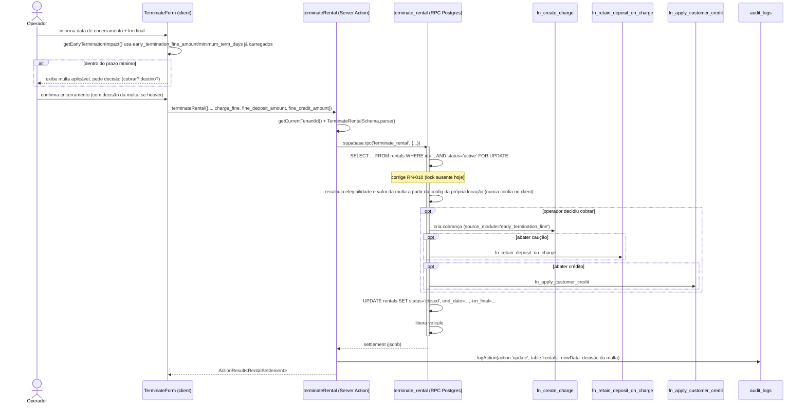

# Spec 0015 — Multa por Rescisão Antecipada de Contrato

> 🟢 **Status: aprovado v1.0** em 2026-09-12. Spec técnica derivada de [[PRDs/0015-multa-rescisao-antecipada]]. Próximo passo: implementar (migration → `packages/core` → Server Actions → UI → testes) e redigir a ADR `0037` proposta em §2.2.

---

## 1. Visão Geral Técnica

A multa por rescisão antecipada deixa de ser uma constante global (`CONTRACT_TERMINATION_FINE_BRL` em `packages/core/src/rules/rentals.ts`) e passa a ser configuração opcional por locação: duas novas colunas em `rentals` (`early_termination_fine_amount`, `minimum_term_days`), preenchidas na criação (RF-001) ou por edição enquanto a locação está ativa (RF-002, RF-008).

**Correção feita durante a implementação, ainda dentro do escopo aprovado**: `isRentalTerminationWithinMinimum`/`calculateMinimumEndDate`/`RENTAL_MINIMUM_DURATION` **não são generalizadas nem removidas** — descobriu-se que essas funções têm um segundo uso, alheio a esta feature: decidir se uma locação `rent_to_own` (compra programada) já foi paga por tempo suficiente para o encerramento virar `status='transferred'` em vez de `'closed'` (usado em `actions.ts::terminateRental` e em `TerminateForm.tsx`). Repurpose-ar essas funções para ler `minimum_term_days` quebraria essa elegibilidade de transferência para todo `rent_to_own` sem multa configurada (toda rescisão viraria `transferred` no dia 1). A Spec passa a introduzir uma função **nova e independente**, `isWithinConfiguredMinimumTerm`, só para a multa — as funções existentes ficam intocadas, continuando a servir exclusivamente a regra de transferência de propriedade do `rent_to_own` (que este PRD nunca pediu para mudar).

A mudança de maior impacto técnico está no encerramento. Hoje o aviso de multa é somente leitura (`getEarlyTerminationImpact`) e o acerto financeiro (caução, crédito) é orquestrado no client em três chamadas de Server Action sequenciais e independentes (`terminateRental` → `closeRentalFinancial` → `applyCreditToRentalDebt`), sem transação distribuída — o que já hoje pode deixar a locação encerrada com o acerto pela metade em caso de falha de rede. O PRD torna essa fragilidade inaceitável para a multa (RN-009: falha parcial nunca pode ficar ambígua) e exige impedir duplo encerramento (RN-010), o que a RPC atual (`terminate_rental`) não garante — ela lê `rentals` sem `FOR UPDATE` e não reconfirma `status = 'active'` no `UPDATE` final, ao contrário do padrão já usado em `fn_adjust_rental_period`. A solução escolhida é mover a decisão da multa e seus abatimentos para **dentro** da própria RPC `terminate_rental`, que passa a: travar a locação (corrigindo RN-010 como efeito colateral necessário, não apenas para a multa), calcular a multa aplicável a partir da configuração da locação, e — quando o operador optou por cobrar — criar a cobrança (via `fn_create_charge`) e aplicar os abatimentos escolhidos (via `fn_retain_deposit_on_charge` / `fn_apply_customer_credit`) tudo na mesma transação Postgres. Isso resolve RN-009 estruturalmente: o banco garante tudo-ou-nada, sem precisar de compensação manual no client.

Componentes envolvidos: `supabase/migrations/` (2 novas colunas em `rentals`, extensão da função `terminate_rental`), `packages/core/src/rules/rentals.ts` (nova função `isWithinConfiguredMinimumTerm`; `getEarlyTerminationImpact` reescrita para ler `early_termination_fine_amount`/`minimum_term_days` da locação em vez de `rental_type`/constante), `packages/core/src/schemas/rentals.ts` (`RentalSchema`, `TerminateRentalSchema` ganham os novos campos), `apps/web/src/app/(dashboard)/locacoes/actions.ts` (`createRental`, `updateRental`, `terminateRental` repassam os novos parâmetros), `apps/web/src/app/(dashboard)/locacoes/_components/TerminateForm.tsx` (UI de decisão: cobrar ou não, e destino do abatimento). Uma nova ADR (`obsidian-notes/decisions/0037-acerto-atomico-de-encerramento-com-multa.md`) documenta a mudança de padrão: mover o acerto financeiro do encerramento de orquestração client-side para transação atômica no Postgres — o PRD já antecipa essa ADR em §11.1.

**Decisões estruturais fechadas nesta Spec:**
- `minimum_term_days` (INTEGER, dias) em vez de meses/anos — mais granular, evita ambiguidade de mês variável, alinhado ao RN-001 (valor livre por locação, não mais atrelado a `contract_type`).
- Config de multa/prazo mínimo como **colunas em `rentals`**, não tabela separada — ao contrário de `deposits`/`customer_credits`, não têm saldo próprio nem ciclo de vida.
- Acerto da multa (cobrança + abatimentos) entra **dentro** da RPC `terminate_rental`, não como Server Actions adicionais.
- A correção do lock ausente em `terminate_rental` (RN-010) é tratada como parte desta Spec — o ponto de mudança é o mesmo.

---

## 2. Arquitetura

### 2.1 Contexto



A configuração (multa/prazo mínimo) entra pelo mesmo caminho já usado para criar/editar locação — `create_rental_with_schedule` (criação) e `updateRental` (edição) — sem componente novo de escrita. O componente genuinamente novo é a extensão da RPC de encerramento, que passa a orquestrar sozinha (dentro do Postgres) o que hoje são 3 chamadas de Server Action separadas e sem transação comum.

### 2.2 Componentes

- `supabase/migrations/<ts>_multa_rescisao_antecipada.sql` — 2 colunas novas em `rentals` (`early_termination_fine_amount`, `minimum_term_days`), nullable, sem valor padrão (RF-001/CA-002); 1 linha nova em `financial_accounts` (`receita_multa_rescisao`); extensão de `create_rental_with_schedule` (2 campos novos no `p_rental` jsonb); extensão de `terminate_rental` (3 parâmetros novos, `FOR UPDATE` na leitura inicial — corrige RN-010, lógica de multa).
- `packages/core/src/rules/rentals.ts` — nova função `isWithinConfiguredMinimumTerm({ start_date, minimum_term_days }, today)`, independente de `isRentalTerminationWithinMinimum`/`RENTAL_MINIMUM_DURATION` (que **ficam intocadas** — servem exclusivamente à elegibilidade de transferência de propriedade do `rent_to_own`, um uso alheio a esta feature); `getEarlyTerminationImpact` reescrita para ler `early_termination_fine_amount`/`minimum_term_days` da locação em vez de `rental_type`/`CONTRACT_TERMINATION_FINE_BRL`. Só `CONTRACT_TERMINATION_FINE_BRL` é removida (sem consumidor depois da migração — confirmar via grep antes de deletar).
- `packages/core/src/schemas/rentals.ts` — `RentalSchema` ganha `early_termination_fine_amount`/`minimum_term_days` opcionais; `TerminateRentalSchema` ganha `charge_fine`, `fine_deposit_amount`, `fine_credit_amount`.
- `apps/web/src/app/(dashboard)/locacoes/actions.ts` — `createRental` repassa os 2 campos novos ao `p_rental` da RPC `create_rental_with_schedule`; `updateRental` ganha os 2 campos na assinatura, com **UPDATE guardado** (`WHERE status = 'active'`) — 0 linhas afetadas quando a locação já foi encerrada → `CONFLICT` (RF-008/RN-007/CA-013); `terminateRental` repassa a decisão da multa à RPC e passa a gravar `newData` explícito em `logAction`.
- `apps/web/src/app/(dashboard)/locacoes/_components/TerminateForm.tsx` — o aviso hoje só-texto vira um passo de decisão real: cobrar/não cobrar (RF-004) e, se cobrar, destino do abatimento (RF-006) — reaproveitando o mesmo padrão visual/de estado já usado para caução e crédito no acerto final (ADR 0026).
- `obsidian-notes/decisions/0037-acerto-atomico-de-encerramento-com-multa.md` — ADR documentando a mudança de padrão (acerto do encerramento migra de Server Actions orquestradas no client para transação atômica na RPC), conforme já antecipado no PRD §11.1. **Fora do escopo desta Spec redigir a ADR — apenas sinalizada aqui.**

### 2.3 Responsabilidades

| Camada | Responsabilidade |
|---|---|
| Zod (`@gomoto/core`) | Formato e limites óbvios do payload (`charge_fine` boolean, valores `>= 0`) — não decide elegibilidade nem soma. |
| Server Action (`actions.ts`) | Resolve tenant, autentica, invoca a RPC, audita a decisão (`logAction` com `newData`), invalida cache (`revalidatePath`). Nunca calcula o valor da multa nem decide destino — só repassa a decisão do operador. |
| RPC `terminate_rental` (Postgres) | Única fonte de verdade: trava a locação, recalcula elegibilidade (RN-002/003) e valor da multa a partir da config gravada em `rentals` (nunca confia em valor vindo do client), valida limites de abatimento (RN-006), orquestra cobrança + abatimentos + fechamento em uma transação. |
| `TerminateForm.tsx` (client) | Só exibe a estimativa (mesma fórmula pura de `packages/core`, para feedback instantâneo) e coleta a decisão do operador — a confirmação real vem da RPC. |

Nota de segurança relevante à arquitetura: nenhuma das funções tocadas (`terminate_rental`, `fn_create_charge`, `fn_retain_deposit_on_charge`, `fn_apply_customer_credit`) é `SECURITY DEFINER` — todas `SECURITY INVOKER` (padrão implícito). Toda leitura/escrita dentro da RPC roda sob a RLS do usuário autenticado; o filtro explícito por `tenant_id` em cada `WHERE` é defesa em profundidade, não uma dependência nova (detalhe completo em §6.2).

---

## 3. Fluxos Técnicos

### 3.1 Fluxo principal

1. Operador abre `/locacoes/[id]/encerrar`; `TerminateForm` já tem a locação carregada, incluindo `early_termination_fine_amount`/`minimum_term_days`.
2. Operador informa `termination_date` e `km_final` (fluxo já existente).
3. Client recalcula `getEarlyTerminationImpact()` — agora lendo `early_termination_fine_amount`/`minimum_term_days` da própria locação em vez de constante global. Se `within_minimum && fine_amount > 0`, a UI exibe a decisão (RF-003).
4. Operador decide: cobrar ou não (RF-004). Se cobrar, escolhe quanto abater de caução e/ou crédito (RF-006) — o restante fica implicitamente "em aberto".
5. Operador confirma. Client chama `terminateRental({ lease_id, termination_date, km_final, force, charge_fine, fine_deposit_amount, fine_credit_amount })`.
6. Server Action autentica, resolve `tenantId`, valida com `TerminateRentalSchema`.
7. Server Action chama `supabase.rpc('terminate_rental', {...})` repassando os novos parâmetros.
8. RPC: `SELECT ... FROM rentals WHERE id=p_rental_id AND tenant_id=p_tenant_id AND status='active' FOR UPDATE` (corrige RN-010).
9. RPC recalcula, a partir da **própria linha travada**: elegibilidade (`p_termination_date < start_date + minimum_term_days`) e `fine_amount` (= `early_termination_fine_amount` ou 0 se nulo/não elegível) — nunca confia em valor vindo do client (RN-002/RN-003).
10. Validações antes de agir:
    - Se `p_charge_fine = true` e `fine_amount = 0` → `RAISE EXCEPTION 'FINE_NOT_APPLICABLE'`.
    - Se `p_fine_deposit_amount + p_fine_credit_amount > fine_amount` → `RAISE EXCEPTION 'FINE_ALLOCATION_EXCEEDS_TOTAL'` (RN-006, primeira metade).
11. Se `p_charge_fine = true`: RPC chama `fn_create_charge` (cliente + locação, `due_date = p_termination_date`, item único `credit_account_code = 'receita_multa_rescisao'`, `amount = fine_amount`) → retorna `fine_charge_id`.
12. Se `p_fine_deposit_amount > 0`: RPC chama `fn_retain_deposit_on_charge(..., p_charge_id = fine_charge_id, p_amount = p_fine_deposit_amount)` — já valida saldo disponível de caução (RN-006, segunda metade).
13. Se `p_fine_credit_amount > 0`: RPC chama `fn_apply_customer_credit(..., p_charge_id = fine_charge_id, p_amount = p_fine_credit_amount)` — mesma validação de saldo para crédito.
14. O que sobrar de `fine_charge_id` sem abatimento fica "em aberto" **automaticamente** — saldo derivado (`charge_balances`) de uma cobrança parcialmente paga; nenhum código adicional cria a "cobrança em aberto" (RF-007/CA-012, ADR 0024 princípio 2).
15. RPC segue o restante da apuração já existente (débitos abertos, cancelamento de cronograma futuro), atualiza `rentals` (status/end_date/km_final) e libera o veículo.
16. RPC retorna `settlement` (jsonb) incluindo `fine_charged`, `fine_amount`, `fine_deposit_amount`, `fine_credit_amount`, `fine_charge_id`.
17. Server Action grava `logAction({ action: 'update', table: 'rentals', recordId, newData: { fine_decision: {...} } })` (RN-008).
18. `revalidatePath` nas rotas de locação; retorno `ActionResult<RentalSettlement>` para a UI.

### 3.2 Fluxos alternativos

- **A1 — Sem multa configurada** (`early_termination_fine_amount IS NULL`): passo 9 calcula `fine_amount = 0`; a UI nem mostra a decisão. Idêntico ao comportamento de hoje.
- **A2 — Fora do prazo mínimo**: passo 9 calcula elegibilidade `false` → `fine_amount = 0`, mesmo caminho de A1.
- **A3 — Operador opta por não cobrar**: `p_charge_fine=false`; passos 11-14 pulados; `settlement.fine_charged=false`.
- **A4 — Configuração via edição**: `updateRental` grava os 2 campos com `UPDATE ... WHERE status='active'`; passa a valer no próximo encerramento — nenhuma migração retroativa.
- **A5 — Quitação combinada**: `p_fine_deposit_amount > 0` **e** `p_fine_credit_amount > 0` no mesmo `terminate_rental` — ambos executam, na mesma transação.

### 3.3 Fluxos de falha

- **E1 — Cobertura parcial**: não é falha — resultado esperado do passo 14 (saldo em aberto derivado). Não bloqueia o encerramento.
- **E2 — Locação já encerrada**:
  - Ao **editar** config: `updateRental` roda `UPDATE rentals SET ... WHERE id=... AND tenant_id=... AND status='active'`; 0 linhas afetadas → `CONFLICT` (CA-013).
  - Ao **encerrar** uma locação já fechada: coberto pelo `RENTAL_NOT_ACTIVE` existente.
- **E3 — Falha parcial no encerramento**: eliminada estruturalmente — `fn_create_charge`, `fn_retain_deposit_on_charge`, `fn_apply_customer_credit` e o `UPDATE` de `rentals` rodam na mesma transação Postgres da RPC. Qualquer `RAISE EXCEPTION` no meio reverte tudo; a locação **não fica** encerrada com multa pela metade. O erro propaga via `ActionResult<{ok:false}>` com código específico.
- **E4 — Ação concorrente**: `SELECT ... FOR UPDATE` do passo 8 serializa; a segunda chamada concorrente espera o lock e, ao continuar, vê `status != 'active'` → `RAISE EXCEPTION 'RENTAL_NOT_ACTIVE'` — apenas uma tentativa é concluída (RN-010).

### 3.4 Eventos

Sem eventos — operação síncrona. Toda a orquestração acontece dentro de uma única invocação da RPC `terminate_rental`, sem webhook, fila ou worker envolvido.

---

## 4. Modelo de Dados

### 4.1 Entidades

Nenhuma tabela nova:

- **`rentals`** — 2 colunas novas: `early_termination_fine_amount`, `minimum_term_days`. Opcionais, sem valor padrão (RF-001/CA-002).
- **`financial_accounts`** — 1 linha nova: `receita_multa_rescisao`.
- **`charges`/`charge_items`/`financial_transactions`/`financial_entries`** — sem mudança de schema; a multa é mais uma cobrança emitida pelo caminho existente (`fn_create_charge`).
- **`deposits`/`customer_credits`** — sem mudança de schema; abatimentos usam as RPCs já existentes.

### 4.2 Campos (SQL concreto)

```sql
-- supabase/migrations/<YYYYMMDDHHMMSS>_multa_rescisao_antecipada.sql
-- Spec 0015 — Multa por Rescisão Antecipada de Contrato

-- ---------------------------------------------------------------------------
-- 1. Configuração por locação (RF-001/RF-002)
-- ---------------------------------------------------------------------------

ALTER TABLE rentals
  ADD COLUMN IF NOT EXISTS early_termination_fine_amount NUMERIC(14,2),
  ADD COLUMN IF NOT EXISTS minimum_term_days INTEGER;

ALTER TABLE rentals
  ADD CONSTRAINT rentals_early_termination_fine_amount_check
    CHECK (early_termination_fine_amount IS NULL OR early_termination_fine_amount > 0),
  ADD CONSTRAINT rentals_minimum_term_days_check
    CHECK (minimum_term_days IS NULL OR minimum_term_days > 0);

COMMENT ON COLUMN rentals.early_termination_fine_amount IS
  'Spec 0015: multa por rescisão antecipada configurada para esta locação. NULL = sem multa configurada (RN-003).';
COMMENT ON COLUMN rentals.minimum_term_days IS
  'Spec 0015: prazo mínimo de vigência, em dias corridos a partir de start_date (RN-001). NULL = sem prazo mínimo configurado.';

-- ---------------------------------------------------------------------------
-- 2. Conta contábil da multa (mesmo catálogo global da migration 02, ADR 0024)
-- ---------------------------------------------------------------------------

-- Toda conta 'revenue' precisa de default_report_line_code não nulo
-- (financial_accounts_report_line_coherent, migration 03/17 — achado durante
-- a implementação, não coberto pela pesquisa inicial). Mesmo tratamento de
-- `receita_encargos_atraso`: outra receita de penalidade ligada ao
-- comportamento do contrato, não ao serviço de locação em si.
INSERT INTO financial_accounts (code, name, kind, normal_direction, is_configurable, sort_order, default_report_line_code, default_in_tax_base)
VALUES ('receita_multa_rescisao', 'Receita de multa por rescisão antecipada', 'revenue', 'credit', true, 225, 'financial_income', true);

-- ---------------------------------------------------------------------------
-- 3. create_rental_with_schedule — ganha os 2 campos na criação (RF-001)
-- ---------------------------------------------------------------------------
-- Mesma assinatura (p_rental é jsonb) — não é overload novo, só 2 chaves a mais
-- lidas do payload. CREATE OR REPLACE é suficiente aqui.

CREATE OR REPLACE FUNCTION public.create_rental_with_schedule(p_tenant_id uuid, p_rental jsonb, p_schedule jsonb)
 RETURNS uuid
 LANGUAGE plpgsql
 SECURITY DEFINER
 SET search_path TO 'public'
AS $function$
DECLARE
  v_rental_id  UUID;
  v_vehicle_id UUID    := (p_rental->>'vehicle_id')::uuid;
  v_km_initial INTEGER := (p_rental->>'km_initial')::integer;
  v_vehicle_km INTEGER;
BEGIN
  SELECT km_current INTO v_vehicle_km FROM vehicles
   WHERE id = v_vehicle_id AND tenant_id = p_tenant_id
     FOR UPDATE NOWAIT;

  IF NOT FOUND THEN
    RAISE EXCEPTION 'VEHICLE_NOT_FOUND';
  END IF;

  IF EXISTS (
    SELECT 1 FROM rentals
     WHERE vehicle_id = v_vehicle_id AND tenant_id = p_tenant_id AND status = 'active'
  ) THEN
    RAISE EXCEPTION 'VEHICLE_ALREADY_RENTED';
  END IF;

  IF v_km_initial IS NOT NULL AND v_km_initial < COALESCE(v_vehicle_km, 0) THEN
    RAISE EXCEPTION 'KM_BELOW_MINIMUM: minimo=%', COALESCE(v_vehicle_km, 0);
  END IF;

  INSERT INTO rentals (
    tenant_id, customer_id, vehicle_id, start_date, end_date,
    cycle, cycle_amount, due_day, use_pro_rata, contract_type,
    status, observations, contract_template_id,
    checkin_checkout_inspection_profile_id, periodic_inspection_profile_id,
    periodic_inspection_frequency_days, km_initial,
    early_termination_fine_amount, minimum_term_days           -- Spec 0015
  )
  SELECT
    p_tenant_id,
    (p_rental->>'customer_id')::uuid,
    v_vehicle_id,
    (p_rental->>'start_date')::date,
    (p_rental->>'end_date')::date,
    p_rental->>'cycle',
    (p_rental->>'cycle_amount')::numeric,
    (p_rental->>'due_day')::smallint,
    COALESCE((p_rental->>'use_pro_rata')::boolean, false),
    COALESCE(p_rental->>'contract_type', 'rental'),
    'active',
    p_rental->>'observations',
    (p_rental->>'contract_template_id')::uuid,
    (p_rental->>'checkin_checkout_inspection_profile_id')::uuid,
    (p_rental->>'periodic_inspection_profile_id')::uuid,
    (p_rental->>'periodic_inspection_frequency_days')::int,
    v_km_initial,
    (p_rental->>'early_termination_fine_amount')::numeric,     -- Spec 0015
    (p_rental->>'minimum_term_days')::int                      -- Spec 0015
  RETURNING id INTO v_rental_id;

  INSERT INTO rental_billing_schedules (
    tenant_id, rental_id, sequence_number, period_start, period_end, due_date, amount
  )
  SELECT
    p_tenant_id, v_rental_id,
    (item->>'sequence_number')::int, (item->>'period_start')::date,
    (item->>'period_end')::date, (item->>'due_date')::date, (item->>'amount')::numeric
  FROM jsonb_array_elements(p_schedule) AS item;

  UPDATE vehicles
     SET status = 'rented', updated_at = now(),
         km_current = COALESCE(v_km_initial, km_current)
   WHERE id = v_vehicle_id AND tenant_id = p_tenant_id;

  RETURN v_rental_id;
END;
$function$;

-- ---------------------------------------------------------------------------
-- 4. terminate_rental — ganha a decisão da multa (RF-003 a RF-007) + trava a
--    locação (RN-010, corrige a lacuna: leitura de hoje não usa FOR UPDATE nem
--    reconfirma status no UPDATE final).
-- ---------------------------------------------------------------------------
-- Assinatura ganha 3 parâmetros novos → função nova para o Postgres, mesmo
-- padrão já usado na migration 20260912234442 ao adicionar p_km_final: DROP
-- explícito da assinatura anterior (evita overload duplicado) + REGRANT
-- explícito (ADR 0034 — ALTER DEFAULT PRIVILEGES não cobre reconceder em cima
-- de DROP).

DROP FUNCTION IF EXISTS terminate_rental(UUID, UUID, DATE, TEXT, BOOLEAN, INTEGER);

CREATE OR REPLACE FUNCTION terminate_rental(
  p_tenant_id           UUID,
  p_rental_id           UUID,
  p_termination_date    DATE,
  p_new_status          TEXT    DEFAULT 'closed',
  p_force               BOOLEAN DEFAULT false,
  p_km_final            INTEGER DEFAULT NULL,
  p_charge_fine         BOOLEAN DEFAULT false,   -- Spec 0015 (RF-004)
  p_fine_deposit_amount NUMERIC DEFAULT 0,       -- Spec 0015 (RF-006)
  p_fine_credit_amount  NUMERIC DEFAULT 0        -- Spec 0015 (RF-006)
) RETURNS JSONB
LANGUAGE plpgsql
AS $$
DECLARE
  v_vehicle_id     UUID;
  v_customer_id    UUID;
  v_km_initial     INTEGER;
  v_vehicle_km     INTEGER;
  v_km_minimum     INTEGER;
  v_open_amount    NUMERIC(14,2);
  v_open_count     INT;
  v_deposit        NUMERIC(14,2);
  v_credit         NUMERIC(14,2);
  v_cancelled      INT;
  v_start_date     DATE;
  v_fine_config    NUMERIC(14,2);
  v_min_term_days  INTEGER;
  v_fine_eligible  BOOLEAN;
  v_fine_amount    NUMERIC(14,2) := 0;
  v_fine_charge_id UUID;
BEGIN
  -- Trava a linha da locação (Spec 0015 / RN-010) — hoje esta SELECT não
  -- travava; duas chamadas concorrentes podiam ambas passar daqui antes do
  -- commit de qualquer uma.
  SELECT vehicle_id, customer_id, km_initial, start_date,
         early_termination_fine_amount, minimum_term_days
    INTO v_vehicle_id, v_customer_id, v_km_initial, v_start_date,
         v_fine_config, v_min_term_days
    FROM rentals
   WHERE id = p_rental_id AND tenant_id = p_tenant_id AND status = 'active'
     FOR UPDATE;

  IF v_vehicle_id IS NULL THEN
    RAISE EXCEPTION 'RENTAL_NOT_ACTIVE';
  END IF;

  IF p_km_final IS NULL THEN
    RAISE EXCEPTION 'KM_FINAL_REQUIRED';
  END IF;

  SELECT km_current INTO v_vehicle_km FROM vehicles
   WHERE id = v_vehicle_id AND tenant_id = p_tenant_id
     FOR UPDATE;

  v_km_minimum := GREATEST(COALESCE(v_vehicle_km, 0), COALESCE(v_km_initial, 0));
  IF p_km_final < v_km_minimum THEN
    RAISE EXCEPTION 'KM_BELOW_MINIMUM: minimo=%', v_km_minimum;
  END IF;

  SELECT COALESCE(SUM(open_amount), 0), COUNT(*)
    INTO v_open_amount, v_open_count
    FROM charge_balances
   WHERE rental_id = p_rental_id AND status = 'open' AND open_amount > 0;

  SELECT COALESCE(balance, 0) INTO v_deposit
    FROM deposit_balances WHERE rental_id = p_rental_id;
  v_deposit := COALESCE(v_deposit, 0);

  SELECT COALESCE(balance, 0) INTO v_credit
    FROM customer_credit_balances
   WHERE tenant_id = p_tenant_id AND customer_id = v_customer_id;
  v_credit := COALESCE(v_credit, 0);

  IF v_open_amount > 0 AND NOT p_force THEN
    RAISE EXCEPTION 'RENTAL_HAS_OPEN_CHARGES: % cobrança(s), total %', v_open_count, v_open_amount
      USING ERRCODE = 'check_violation';
  END IF;

  -- Spec 0015 — elegibilidade e valor da multa recalculados aqui, nunca a
  -- partir do que o client mandou (RN-002/RN-003). start_date + minimum_term_days
  -- é o mesmo cálculo de isWithinConfiguredMinimumTerm() (packages/core) —
  -- independente de isRentalTerminationWithinMinimum()/RENTAL_MINIMUM_DURATION,
  -- que continuam servindo só à elegibilidade de transferência do rent_to_own.
  v_fine_eligible := v_fine_config IS NOT NULL
                  AND v_min_term_days IS NOT NULL
                  AND p_termination_date < (v_start_date + v_min_term_days);

  IF v_fine_eligible THEN
    v_fine_amount := v_fine_config;
  END IF;

  IF p_charge_fine AND NOT v_fine_eligible THEN
    RAISE EXCEPTION 'FINE_NOT_APPLICABLE';
  END IF;

  IF p_charge_fine AND (p_fine_deposit_amount + p_fine_credit_amount) > v_fine_amount THEN
    RAISE EXCEPTION 'FINE_ALLOCATION_EXCEEDS_TOTAL: multa=%, alocado=%',
      v_fine_amount, p_fine_deposit_amount + p_fine_credit_amount;
  END IF;

  IF p_charge_fine THEN
    -- fn_create_charge, fn_retain_deposit_on_charge e fn_apply_customer_credit
    -- já existem (ADR 0026) — chamados aqui dentro da MESMA transação em vez
    -- de 3 Server Actions separadas (RN-009).
    v_fine_charge_id := (fn_create_charge(
      p_tenant_id,
      jsonb_build_object(
        'customer_id',    v_customer_id,
        'rental_id',      p_rental_id,
        'due_date',       p_termination_date,
        'source_module',  'early_termination_fine',
        'source_id',      p_rental_id
      ),
      jsonb_build_array(jsonb_build_object(
        'description',          'Multa por rescisão antecipada',
        'credit_account_code',  'receita_multa_rescisao',
        'quantity',              1,
        'unit_amount',           v_fine_amount,
        'amount',                v_fine_amount
      ))
    )->>'charge_id')::uuid;

    IF p_fine_deposit_amount > 0 THEN
      PERFORM fn_retain_deposit_on_charge(
        p_tenant_id, p_rental_id, v_fine_charge_id, p_fine_deposit_amount,
        'Multa por rescisão antecipada'
      );
    END IF;

    IF p_fine_credit_amount > 0 THEN
      PERFORM fn_apply_customer_credit(
        p_tenant_id, v_customer_id, v_fine_charge_id, p_fine_credit_amount
      );
    END IF;
  END IF;

  UPDATE rental_billing_schedules
     SET status = 'cancelled', updated_at = now()
   WHERE tenant_id = p_tenant_id
     AND rental_id = p_rental_id
     AND status    = 'scheduled'
     AND period_start > p_termination_date;

  GET DIAGNOSTICS v_cancelled = ROW_COUNT;

  UPDATE rentals
     SET status = p_new_status, end_date = p_termination_date, km_final = p_km_final, updated_at = now()
   WHERE id = p_rental_id AND tenant_id = p_tenant_id AND status = 'active';

  IF NOT FOUND THEN
    -- Segunda chamada concorrente que esperou o FOR UPDATE e chegou aqui
    -- depois que a primeira já commitou (RN-010).
    RAISE EXCEPTION 'RENTAL_NOT_ACTIVE';
  END IF;

  UPDATE vehicles
     SET status = 'available', updated_at = now(), km_current = p_km_final
   WHERE id = v_vehicle_id AND tenant_id = p_tenant_id;

  RETURN jsonb_build_object(
    'rental_id',            p_rental_id,
    'customer_id',          v_customer_id,
    'open_amount',          v_open_amount,
    'open_charges',         v_open_count,
    'deposit_balance',      v_deposit,
    'credit_balance',       v_credit,
    'cancelled_schedules',  v_cancelled,
    'requires_settlement',  v_deposit > 0 OR v_open_amount > 0 OR v_credit > 0,
    'fine_eligible',        v_fine_eligible,
    'fine_charged',         p_charge_fine,
    'fine_amount',          v_fine_amount,
    'fine_deposit_amount',  p_fine_deposit_amount,
    'fine_credit_amount',   p_fine_credit_amount,
    'fine_charge_id',       v_fine_charge_id
  );
END;
$$;

COMMENT ON FUNCTION terminate_rental IS
  'Spec 0015: trava a locação (FOR UPDATE) e resolve a multa por rescisão antecipada — cobrança e abatimentos na mesma transação do encerramento.';

REVOKE EXECUTE ON FUNCTION terminate_rental(UUID, UUID, DATE, TEXT, BOOLEAN, INTEGER, BOOLEAN, NUMERIC, NUMERIC) FROM PUBLIC, anon;
GRANT  EXECUTE ON FUNCTION terminate_rental(UUID, UUID, DATE, TEXT, BOOLEAN, INTEGER, BOOLEAN, NUMERIC, NUMERIC) TO authenticated, service_role;
```

### 4.3 Relacionamentos e índices

- Nenhum FK novo — `early_termination_fine_amount`/`minimum_term_days` são escalares na própria `rentals`.
- Nenhum índice novo — os campos só são lidos por `id` da própria locação (nunca filtrados/agrupados em listagem); `receita_multa_rescisao` cai na `PRIMARY KEY (code)` já existente de `financial_accounts`.
- A cobrança da multa (`charges`) herda todos os índices existentes de `rental_id`/`customer_id`/`source_module`.
- A guarda contra editar configuração de locação encerrada (RF-008/RN-007) **não** é uma constraint declarativa — é um `UPDATE ... WHERE status = 'active'` na Server Action `updateRental` (guarda+escrita na mesma instrução, sem precisar de RPC dedicada porque não há efeito colateral a orquestrar além do próprio `UPDATE`). Ver §5.1.

---

## 5. APIs

### 5.1 Endpoints (Server Actions estendidas — nenhuma nova)

| Server Action | Arquivo | Mudança |
|---|---|---|
| `createRental(data: CreateRental)` | `apps/web/src/app/(dashboard)/locacoes/actions.ts` | `RentalSchema` validado já inclui `early_termination_fine_amount`/`minimum_term_days`; repassados em `p_rental` para `create_rental_with_schedule` (RF-001). |
| `updateRental(leaseId, data)` | idem | `Pick<CreateRental, ...>` ganha os 2 campos; `UPDATE` correspondente ganha `.eq('status', 'active')` e trata 0 linhas afetadas como `CONFLICT` (RF-002/RF-008). |
| `terminateRental(data: TerminateRental)` | idem | `TerminateRentalSchema` ganha `charge_fine`/`fine_deposit_amount`/`fine_credit_amount`; repassados para a RPC `terminate_rental`; `logAction` passa a gravar `newData` com a decisão da multa (RN-008). |

Nenhuma rota HTTP nova, nenhum route handler novo — padrão GoMoto de Server Action co-localizada em `actions.ts` (ADR 0002).

### 5.2 Schemas (Zod via `@gomoto/core`)

```ts
// packages/core/src/schemas/rentals.ts — extensão de RentalSchema (criação, RF-001)
export const RentalSchema = z.object({
  // ...campos existentes inalterados...
  early_termination_fine_amount: z.number().positive('Multa deve ser maior que zero').nullable().optional(),
  minimum_term_days: z.number().int().positive('Prazo mínimo deve ser maior que zero dias').nullable().optional(),
})
export type CreateRental = z.infer<typeof RentalSchema>
```

```ts
// packages/core/src/schemas/rentals.ts — extensão de TerminateRentalSchema (RF-004/RF-006)
export const TerminateRentalSchema = z.object({
  lease_id: z.string().uuid(),
  termination_date: dateString,
  new_status: z.enum(['closed', 'transferred']).default('closed'),
  force: z.boolean().optional().default(false),
  km_final: z.number().int().nonnegative({ error: 'Km final inválido' }),
  charge_fine: z.boolean().optional().default(false),
  fine_deposit_amount: z.number().min(0).optional().default(0),
  fine_credit_amount: z.number().min(0).optional().default(0),
}).refine(
  (d) => !d.charge_fine ? (d.fine_deposit_amount === 0 && d.fine_credit_amount === 0) : true,
  { message: 'Só é possível abater caução/crédito quando a multa é cobrada', path: ['charge_fine'] },
)
export type TerminateRental = z.infer<typeof TerminateRentalSchema>
```

`updateRental` não ganha schema novo — sua assinatura já é `Pick<CreateRental, ...>`; basta acrescentar `'early_termination_fine_amount' | 'minimum_term_days'` à união de chaves do `Pick`. O Zod continua único (`RentalSchema`), sem duplicação em `apps/web`.

### 5.3 Erros

| Código (`ActionResult`) | Origem (exceção Postgres) | Quando ocorre |
|---|---|---|
| `VALIDATION_ERROR` | Zod | `charge_fine=false` mas veio `fine_deposit_amount`/`fine_credit_amount` > 0; ou multa/prazo mínimo ≤ 0 |
| `CONFLICT` | — (guarda de app) | `updateRental` tenta alterar multa/prazo mínimo de locação com `status != 'active'` (0 linhas afetadas) |
| `CONFLICT` | `RENTAL_NOT_ACTIVE` | `terminate_rental` não encontra a locação `active` — leitura inicial **ou** `UPDATE` final (RN-010) |
| `CONFLICT` | `FINE_NOT_APPLICABLE` | Client mandou `charge_fine=true`, mas a RPC recalculou e a multa não é elegível |
| `VALIDATION_ERROR` | `FINE_ALLOCATION_EXCEEDS_TOTAL` | Soma dos abatimentos excede o valor da multa (RN-006, 1ª metade) |
| `VALIDATION_ERROR` | `AMOUNT_EXCEEDS_DEPOSIT` | Abatimento de caução excede o saldo disponível (RN-006, 2ª metade) — propagado de `fn_retain_deposit_on_charge` |
| `VALIDATION_ERROR` | `AMOUNT_EXCEEDS_BALANCE` | Abatimento de crédito excede o saldo do cliente (RN-006, 2ª metade) — propagado de `fn_apply_customer_credit` |
| `NOT_FOUND` | `DEPOSIT_NOT_FOUND` | Pediu abater da caução, mas a locação não tem depósito aberto |
| `UNAUTHORIZED`/`FORBIDDEN` | — | Sem sessão / RLS bloqueia |

---

## 6. Segurança

### 6.1 Autenticação

Sem mecanismo novo. `createRental`, `updateRental` e `terminateRental` já validam sessão via `supabase.auth.getUser()` antes de qualquer leitura/escrita.

### 6.2 Autorização

- `getCurrentTenantId(supabase)` resolve o tenant **server-side** — mesmo padrão já usado nas 3 actions hoje.
- Nenhuma das funções tocadas (`terminate_rental`, `fn_create_charge`, `fn_retain_deposit_on_charge`, `fn_apply_customer_credit`, `post_financial_transaction`) é `SECURITY DEFINER`. Toda leitura/escrita dentro da RPC roda sob a RLS do usuário autenticado — a política `tenant_isolation_*` de `rentals`, `charges`, `deposits`, `customer_credits` e `financial_entries` se aplica em cada statement, mesmo os aninhados. O filtro explícito por `p_tenant_id` em cada `WHERE` é defesa em profundidade, já usada em todo o módulo.
- `financial_accounts` é catálogo global sem `tenant_id` (exceção deliberada do ADR 0024) — a linha nova segue a policy já existente `financial_accounts_read`.
- RNF-002 fica garantido pelo mesmo mecanismo já validado para todo o resto do módulo — nenhuma tabela/policy nova.
- Nenhuma distinção de papel/cargo para decidir cobrar ou não (RF-004) — igual ao acerto de caução/crédito do ADR 0026: a proteção é o rastro auditável (RN-008), não um gate de permissão.

### 6.3 Auditoria

RN-008 exige que toda decisão sobre a multa fique consultável e associada a quem decidiu. As 3 Server Actions já chamam `logAction`, mas nenhuma grava `newData` com informação suficiente — a Spec fecha esse gap:

- **`createRental`** — `newData: { schedule_lines, early_termination_fine_amount, minimum_term_days }` (hoje só grava `schedule_lines`).
- **`updateRental`** — `newData: { early_termination_fine_amount, minimum_term_days }` quando esses campos vierem no payload (hoje não grava `newData`).
- **`terminateRental`** — `newData: { fine_decision: { charged, amount, deposit_amount, credit_amount, charge_id } }` (hoje não grava `newData`).

`audit_logs.user_id` já identifica "quem" — nenhuma coluna nova. Retenção: mesma da tabela hoje (indefinida, `INSERT`-only).

---

## 7. Observabilidade

### 7.1 Logs essenciais

O projeto não tem camada de logging estruturado dedicada — o padrão real (`apps/web/src/lib/financial/charges.ts:145-155`) é `console.warn`/`console.error` com `JSON.stringify({ ts, level, action, ...contexto })` nos pontos onde uma falha inesperada mexe com dinheiro. Aplicado ao ponto novo:

- **`terminateRental` — fallback de erro não mapeado**: quando a RPC falha com um código que não é nenhum dos tratados em §5.3, grava:
  ```ts
  console.error(JSON.stringify({
    ts: new Date().toISOString(), level: 'error', action: 'rental.terminate_with_fine_failed',
    tenant_id: tenantId, rental_id: parsed.data.lease_id, charge_fine: parsed.data.charge_fine,
    error: error.message,
  }))
  ```
- Sem PII bruta no log — só `tenant_id`/`rental_id` (UUIDs).

### 7.2 Métricas e alertas

N/A — feature não crítica o suficiente para justificar infraestrutura de métricas que o projeto não tem hoje (sem Prometheus/APM). O sinal operacional real já existe: `audit_logs` (RN-008) permite consulta manual, e o `console.error` acima aparece nos logs de runtime da Vercel se a RPC falhar de forma inesperada.

---

## 8. Performance e Escalabilidade

Sem requisitos materiais — comportamento padrão Vercel + Supabase. RNF-001 pede apenas "sem atraso perceptível em relação ao comportamento atual", sem número-alvo; toda a orquestração roda numa única RPC já existente, sem I/O de rede extra em relação ao fluxo de hoje.

---

## 9. Test Strategy

### 9.1 Unit tests (Vitest em `packages/core`)

- **`packages/core/src/rules/rentals.spec.ts`** (já existe, estende):
  - **Nova** `isWithinConfiguredMinimumTerm({ start_date, minimum_term_days }, today)`: dentro do prazo → `true`; exatamente na data-limite (`start_date + minimum_term_days`) → `false` (CA-006); depois do prazo → `false`; `minimum_term_days = null` → sempre `false`. `isRentalTerminationWithinMinimum`/`calculateMinimumEndDate`/`RENTAL_MINIMUM_DURATION` **não mudam** — seus testes existentes continuam valendo como estão (servem à elegibilidade de transferência do `rent_to_own`, alheia a esta feature).
  - `getEarlyTerminationImpact` lendo `early_termination_fine_amount` da própria locação: com config + dentro do prazo → `fine_amount = early_termination_fine_amount`; sem config → `fine_amount = 0`; com config mas fora do prazo → `fine_amount = 0`.
- **`packages/core/src/schemas/rentals.spec.ts`** (já existe, estende):
  - `RentalSchema`: aceita campos ausentes (CA-002); rejeita `0`/negativo em qualquer um dos dois.
  - `TerminateRentalSchema`: `charge_fine` default `false`; `.refine()` rejeita abatimentos > 0 quando `charge_fine=false`.

### 9.2 Testes end-to-end e de integração (Playwright em `apps/web/tests/`)

Este repositório não separa `tests/e2e/` de uma camada de integração distinta — `apps/web/tests/*.spec.ts` é uma pasta só, e o mesmo arquivo Playwright mistura passos de browser com chamadas diretas de RPC via `getSupabaseAdmin()` (service_role) quando o cenário é sobre garantia de banco. Precedentes de referência: `ajuste-de-periodo.spec.ts:295-313` (locação encerrada recusa RPC) e `pagamento-despesa.spec.ts:141-157` (`Promise.allSettled` + `okCount===1` para dupla execução concorrente).

Novo arquivo: **`apps/web/tests/multa-rescisao-antecipada.spec.ts`**, usando os helpers existentes (`getSupabaseAdmin`, `getTestTenantId`, `createTestVehicle`, `createTestCustomer`).

| Teste | Cobre |
|---|---|
| Cria locação com multa configurada, encerra dentro do prazo, cobra e abate 100% da caução | CA-001, CA-005, CA-008, CA-009, CA-010 |
| Locação sem multa configurada — encerramento não exibe nem cobra nada | CA-002 |
| Locação com multa configurada, mas encerrada depois do prazo mínimo — nenhuma multa | CA-006 |
| Operador decide não cobrar a multa exibida | CA-007 |
| Edição de locação ativa adiciona/altera multa e prazo mínimo | CA-003, CA-004 |
| Quitação combinada: parte caução + parte crédito, resto vira cobrança em aberto | CA-011, CA-012 |
| Locação já encerrada recusa alteração de multa/prazo mínimo (`updateRental` retorna `CONFLICT`) | CA-013, RN-007 |
| `charge_fine=true`, mas a RPC recalcula e a multa não é elegível → `FINE_NOT_APPLICABLE` (com asserção de que `rentals.status` permanece `'active'`) | RN-002, RN-009 |
| `fine_deposit_amount + fine_credit_amount` excede o valor da multa → `FINE_ALLOCATION_EXCEEDS_TOTAL` (com asserção de que `rentals.status` permanece `'active'`) | RN-006, RN-009 |
| Duas chamadas concorrentes de `terminate_rental` para a mesma locação — só uma é aceita | RN-010 |

### 9.3 Integration / Contract

N/A como camada separada — este repositório não distingue Unit/E2E/Integration por pasta: as garantias de banco (concorrência RN-010, limites de saldo RN-006) já são cobertas em §9.2, no mesmo arquivo Playwright, chamando a RPC diretamente via `getSupabaseAdmin()` sem passar pelo browser. Não há integração com sistema externo nesta feature.

---

## 10. Deploy e Rollback

**Ordem:** migration (`supabase db push`, controlado por humano em produção) → deploy de `apps/web`/`packages/core`. A migration precisa ir **antes e junto** — `terminate_rental` muda de assinatura (6 → 9 parâmetros) via `DROP FUNCTION` + `CREATE`; se o código novo subir antes da migration, `terminateRental` chama a RPC com 9 parâmetros que ainda não existem. Se a migration subir sem o deploy do app, nada quebra (a RPC aceita os 3 novos parâmetros com `DEFAULT`, então o código antigo continua funcionando com `charge_fine` implicitamente `false`). Sem feature flag — não é introduzida uma para esta feature.

**Rollback:**
- **Antes de qualquer uso real**: reverter o commit do `apps/web`/`packages/core` é suficiente — as 2 colunas novas em `rentals` ficam órfãs até uma migration de limpeza futura.
- **Depois que alguma multa já foi cobrada**: não é rollback de schema — `charges`/`financial_entries` são imutáveis por design (ADR 0024, princípio 5). Reverter significa **estornar** a cobrança pelo mecanismo já existente (`cancelCharge`).
- `DROP FUNCTION terminate_rental(9 params)` + recriar a versão de 6 parâmetros reverteria a RPC, mas só é seguro se nenhuma locação tiver sido encerrada com a versão nova entre o deploy e o rollback.

---

## 11. Riscos Técnicos e Questões Abertas

### 11.1 Riscos

- **Janela de deploy migration→app**: mitigada pela ordem documentada em §10 e pelos `DEFAULT` dos parâmetros novos.
- **Mudança de comportamento em função crítica já em produção**: o `FOR UPDATE` + recheck de `status='active'` em `terminate_rental` afeta todo encerramento, não só o caminho com multa. Mitigação: os testes de §9.2 cobrem os fluxos existentes (débito em aberto com `p_force`, `rent_to_own` → `transferred`) além dos novos.
- **Limpeza de código morto** (`CONTRACT_TERMINATION_FINE_BRL`, `ErrorCode 'TERMINATION_FINE_APPLICABLE'`): confirmar via `grep -r` antes de deletar, na implementação. `RENTAL_MINIMUM_DURATION` **não** é removida — continua em uso pela elegibilidade de transferência do `rent_to_own` (achado durante a implementação, ver §1).
- **Chamada aninhada de função a função dentro do Postgres** (`terminate_rental` chamando as 3 funções do ADR 0026): todas `SECURITY INVOKER`, mesma sessão/transação — confirmar no primeiro teste de integração que não há surpresa de contexto.

### 11.2 Questões abertas

- [ ] Remover o `ErrorCode 'TERMINATION_FINE_APPLICABLE'` morto (`packages/core/src/types/index.ts`) faz parte do mesmo PR desta feature, ou fica para um PR de limpeza separado? Não bloqueia a implementação — decisão de escopo do PR.
- [ ] RN-008 (auditoria da decisão) foi implementada (`logAction` com `newData.fine_decision` nas 3 Server Actions) e verificada por leitura de código + typecheck, mas não tem teste automatizado — a suíte `multa-rescisao-antecipada.spec.ts` testa a RPC direto via service_role (mesma camada de `billings-rentals.spec.ts`), abaixo de onde `logAction` roda. Cobertura completa exige um teste de browser (Playwright com `page`, passando pela Server Action de verdade) — recomendado como próximo passo, não bloqueia merge.

---

## 12. Matriz de Rastreabilidade e Aprovação

### 12.1 Matriz

| PRD Item | Descrição curta | Seção(ões) da Spec | Cobertura de Testes |
|---|---|---|---|
| RF-001 | Multa/prazo mínimo opcionais na criação da locação | §2.2, §4.1, §4.2, §5.2 | Unit: `packages/core/src/schemas/rentals.spec.ts::RentalSchema aceita campos ausentes/rejeita ≤0`; E2E: `apps/web/tests/multa-rescisao-antecipada.spec.ts::cria locação com multa configurada, encerra dentro do prazo` |
| RF-002 | Adicionar/alterar multa/prazo mínimo em locação ativa | §2.2, §5.1 | E2E: `multa-rescisao-antecipada.spec.ts::edição de locação ativa adiciona/altera multa e prazo mínimo` |
| RF-003 | Exibe multa aplicável ao iniciar encerramento dentro do prazo | §2.2, §3.1 (passo 3) | Unit: `rentals.spec.ts::getEarlyTerminationImpact` (com config, dentro do prazo); E2E: `multa-rescisao-antecipada.spec.ts::locação com multa configurada, mas encerrada depois do prazo mínimo` |
| RF-004 | Operador opta por cobrar ou não antes de confirmar | §3.1 (passos 4-5), §5.2 | E2E: `multa-rescisao-antecipada.spec.ts::operador decide não cobrar a multa exibida` |
| RF-005 | Cobrança gerada, vinculada a cliente e locação | §3.1 (passo 11), §4.2 | E2E: `multa-rescisao-antecipada.spec.ts::cria locação com multa configurada, encerra dentro do prazo, cobra e abate 100% da caução` |
| RF-006 | Abate da caução e/ou crédito no mesmo ato | §3.1 (passos 12-13), §4.2 | E2E: mesmo teste de RF-005; `multa-rescisao-antecipada.spec.ts::quitação combinada` |
| RF-007 | Restante não coberto vira cobrança em aberto | §3.1 (passo 14), §3.3 (E1) | E2E: `multa-rescisao-antecipada.spec.ts::quitação combinada: parte caução + parte crédito, resto vira cobrança em aberto` |
| RF-008 | Impede alterar config de locação já encerrada | §4.3, §5.1 | E2E: `multa-rescisao-antecipada.spec.ts::locação já encerrada recusa alteração de multa/prazo mínimo` |
| RNF-001 | Sem atraso perceptível na exibição/geração | §8 | N/A — sem número-alvo no PRD; toda a orquestração roda numa única RPC já existente, sem I/O extra |
| RNF-002 | Isolamento por tenant igual ao resto do módulo | §6.2 | N/A — herdado da RLS já existente; nenhuma tabela/policy nova |
| RN-001 | Prazo mínimo contado a partir de `start_date`, valor da própria locação | §3.1 (passo 9), §4.2 | Unit: `rentals.spec.ts::isWithinConfiguredMinimumTerm usa minimum_term_days da locação` |
| RN-002 | Multa só aplicável com config **e** dentro do prazo | §3.1 (passos 9-10), §4.2 | Unit: `rentals.spec.ts::getEarlyTerminationImpact`/`isWithinConfiguredMinimumTerm`; E2E: `multa-rescisao-antecipada.spec.ts::FINE_NOT_APPLICABLE` |
| RN-003 | Sem config, nunca exibe nem cobra | §3.2 (A1) | Unit: `rentals.spec.ts::getEarlyTerminationImpact com fine null`; E2E: `multa-rescisao-antecipada.spec.ts::locação sem multa configurada` |
| RN-004 | Decisão de cobrar não pode ser desfeita após confirmar | §3.1 | N/A — estrutural: nenhuma Server Action edita a decisão de multa após o encerramento |
| RN-005 | Destino da multa é decisão própria, independente de outras dívidas | §3.1 | Unit: `rentals.spec.ts::TerminateRentalSchema` (refine); E2E: `multa-rescisao-antecipada.spec.ts::quitação combinada` |
| RN-006 | Soma abatida ≤ multa; cada abatimento ≤ saldo da fonte | §3.1 (passo 10) | E2E: `multa-rescisao-antecipada.spec.ts::FINE_ALLOCATION_EXCEEDS_TOTAL`; teto por fonte herdado das validações de `fn_retain_deposit_on_charge`/`fn_apply_customer_credit` |
| RN-007 | Config não pode ser alterada após encerramento | §4.3, §5.1 | E2E: `multa-rescisao-antecipada.spec.ts::locação já encerrada recusa alteração de multa/prazo mínimo` |
| RN-008 | Toda decisão auditável, associada a quem decidiu | §6.3 | N/A — `logAction(newData: fine_decision)` mora na Server Action (`actions.ts`), uma camada acima da RPC `terminate_rental`. `multa-rescisao-antecipada.spec.ts` chama a RPC direto via service_role (mesmo padrão de `billings-rentals.spec.ts`) e não passa pela Server Action — cobertura completa de RN-008 exige um teste de browser, não incluído nesta Spec (ver §11.2) |
| RN-009 | Falha parcial nunca deixa estado ambíguo | §1, §3.3 (E3) | E2E: `multa-rescisao-antecipada.spec.ts::FINE_NOT_APPLICABLE`/`FINE_ALLOCATION_EXCEEDS_TOTAL` — asserção de que `rentals.status` permanece `'active'` |
| RN-010 | Apenas uma tentativa de encerrar pode ter sucesso | §3.1 (passo 8), §3.3 (E4), §4.2 | E2E: `multa-rescisao-antecipada.spec.ts::duas chamadas concorrentes de terminate_rental — só uma é aceita` |

### 12.2 Checklist de aprovação

- [x] Sem placeholders `<!-- preencher -->`
- [x] Nenhuma tabela nova em §4 (só colunas em `rentals` já coberta por RLS existente + 1 linha em catálogo global `financial_accounts`)
- [x] Decisão arquitetural não trivial (mover acerto do encerramento para dentro da RPC) referenciada — ADR `0037` proposta em §2.2
- [x] Matriz §12.1 cobre 100% dos RF/RNF/RN do PRD
- [x] Anti-padrões GoMoto não adotados — schemas únicos em `@gomoto/core`, mutação via Server Action + RPC, sem lógica de negócio em handler de UI

**Aprovado por:** Alan em 2026-09-12
