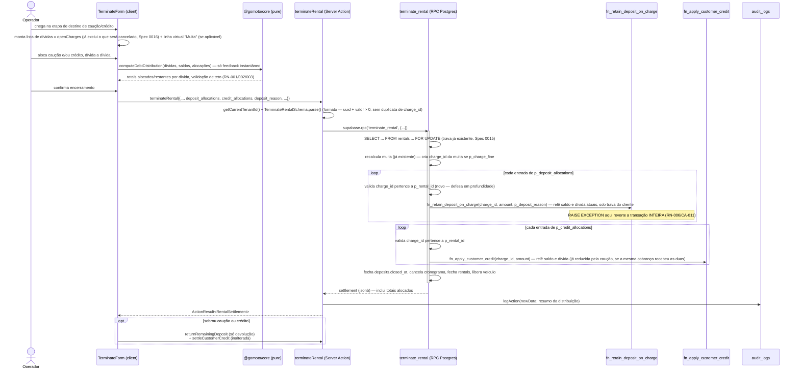

# Spec 0017 — Distribuição dirigida de caução e crédito no encerramento

> 🟢 **Status: aprovado v1.0** em 2026-09-18, **implementada em 2026-09-21** (migration → `packages/core` → Server Actions → UI → testes). Spec técnica derivada de [[PRDs/0017-abatimento-caucao-credito]]. A implementação divergiu do aprovado em três pontos (mais um pedido posterior sobre o crédito), registrados em **§13** — o mais relevante é a guarda `CHARGE_NOT_OPEN`, que a §4 não previa.

---

## 1. Visão Geral Técnica

A tela de Encerramento (`/locacoes/[id]/encerrar`) substitui o "Acerto final" agregado (ADR 0026) por uma **distribuição dirigida**: o operador aloca caução e crédito dívida a dívida, contra cada cobrança em aberto da locação (qualquer origem — ciclo, multa, entrada, despesa rateada), em vez de escolher um valor único (devolver/reter/abater tudo) que o sistema distribuía sozinho, da mais antiga para a mais nova.

A mudança de maior impacto técnico é onde essa distribuição roda. Hoje ela é feita por duas Server Actions chamadas sequencialmente pelo client depois que `terminateRental` já fechou a locação — `closeRentalFinancial` (caução, laço `fn_retain_deposit_on_charge` por cobrança aberta, da mais antiga) e `applyCreditToRentalDebt` (crédito, mesmo padrão via `fn_apply_customer_credit`) — nenhuma das duas é atômica entre si nem com o encerramento: se a terceira chamada falhar, as anteriores já foram commitadas (comportamento documentado e aceito na ADR 0026 e no código de `applyCreditToRentalDebt`). O RN-006 deste PRD ("nada aplicado pela metade") exige o oposto. A solução é a mesma já usada pela Spec 0015 para a multa: mover a distribuição para **dentro** da RPC `terminate_rental`, que ganha três parâmetros novos (`p_deposit_allocations`/`p_credit_allocations`, arrays JSONB de `{charge_id, amount}`, e `p_deposit_reason`, motivo global da distribuição de caução) processados no mesmo bloco interno que já existe para a multa (`fn_retain_deposit_on_charge`/`fn_apply_customer_credit`, um por linha, sob a mesma trava de cliente) — tudo na mesma transação que fecha a locação. `closeRentalFinancial` e `applyCreditToRentalDebt` são removidas: grep confirma que `TerminateForm.tsx` é o único chamador de ambas.

A multa por rescisão antecipada (RN-007) deixa de ter os dois inputs isolados que a Spec 0015 introduziu (`fine_deposit_amount`/`fine_credit_amount` como decisão separada, com seção própria) e passa a ser só mais uma linha da mesma tabela de distribuição na UI — mas como o `charge_id` da multa só existe depois que a RPC a cria internamente (quando `p_charge_fine = true`), os parâmetros escalares `p_fine_deposit_amount`/`p_fine_credit_amount` da Spec 0015 são preservados na assinatura da RPC; é a UI que deixa de tratá-los como seção própria e passa a alimentá-los a partir da linha virtual "Multa" da mesma lista. A sobra pós-distribuição (RF-008/RF-009) deixa de ter uma opção de "retenção agregada" — reter só existe dívida a dívida, dentro da distribuição — e passa a significar apenas devolver ou deixar como está; isso reduz `closeRentalFinancial` a um caminho bem menor (renomeado para `returnRemainingDeposit`, só devolução do restante, fora da RPC, mesma tolerância a falha parcial que `settleCustomerCredit` já tem hoje nesse ponto). A RPC também passa a fechar `deposits.closed_at` incondicionalmente ao encerrar (mesmo comportamento de hoje, só que atomizado para dentro da transação).

Componentes envolvidos: `supabase/migrations/` (`terminate_rental` ganha 13 parâmetros; `charge_balances` ganha a coluna `source_module`), `packages/core/src/rules/settlement.ts` (novo — função pura `computeDebtDistribution`, feedback instantâneo da UI), `packages/core/src/schemas/rentals.ts` (`TerminateRentalSchema` ganha os arrays de alocação e o motivo; novo `ReturnRemainingDepositSchema`), `apps/web/src/app/(dashboard)/locacoes/actions.ts` (`terminateRental` repassa os arrays; `closeRentalFinancial` reduzida a `returnRemainingDeposit`; `applyCreditToRentalDebt` removida), `apps/web/src/app/(dashboard)/locacoes/_components/TerminateForm.tsx` (nova seção "Distribuição de caução e crédito" substitui "Destino da caução"/"Destino do crédito"/"Multa por rescisão antecipada" como inputs separados).

---

## 2. Arquitetura

### 2.1 Contexto



O ponto central: a distribuição inteira (caução + crédito, dívida a dívida, incluindo a multa quando cobrada) roda **dentro** da mesma transação que já trava a locação e já cria a cobrança da multa (Spec 0015). Isso é o que dá RN-006 de graça — qualquer `RAISE EXCEPTION` no meio (dívida que mudou de estado, saldo insuficiente) reverte tudo, sem precisar de lógica de compensação no client. O "sobra pós-distribuição" (RF-008/009) continua fora da RPC, como hoje: é decisão sobre o que **não** foi distribuído, não sobre dívida — mesma tolerância a falha parcial que `returnRemainingDeposit`/`settleCustomerCredit` já têm nesse ponto específico (não é escopo deste PRD mudar isso).

### 2.2 Componentes

- `supabase/migrations/<ts>_distribuicao_dirigida_caucao_credito.sql` — `terminate_rental` ganha 3 parâmetros (`p_deposit_allocations JSONB DEFAULT '[]'`, `p_credit_allocations JSONB DEFAULT '[]'`, `p_deposit_reason TEXT DEFAULT NULL`) e dois blocos novos no corpo: o loop de distribuição (entre o tratamento da multa e o cancelamento de cronograma, ambos inalterados) e o fechamento incondicional de `deposits.closed_at`. Assinatura muda → `DROP FUNCTION` explícito + `GRANT` reafirmado. `charge_balances` ganha a coluna `source_module` (apensa ao final da lista de colunas).
- `packages/core/src/rules/settlement.ts` (**novo**) — `computeDebtDistribution(debts, balances, allocations)`, função pura: recebe as dívidas visíveis (incluindo a linha virtual da multa quando aplicável), os saldos de caução/crédito, e o que o operador já alocou; devolve por linha (`allocated_deposit`, `allocated_credit`, `remaining`) e os totais/erros de teto (RN-001/002/003) — só para feedback instantâneo da UI (RNF: sem round-trip por dígito). Não é revalidada no servidor por uma cópia dela mesma: a verdade final é a RPC, que já reconfere saldo e dívida a cada `fn_retain_deposit_on_charge`/`fn_apply_customer_credit` sob trava (diferente do padrão `plan*`/`load*Plan` da Spec 0016, que precisa de revalidação server-side porque `cancelCharge` roda **fora** da transação da RPC — aqui a distribuição roda inteira **dentro** dela).
- `packages/core/src/schemas/rentals.ts` — `TerminateRentalSchema` ganha `deposit_allocations`/`credit_allocations` (arrays de `{ charge_id: uuid, amount: number positivo }`, sem `charge_id` duplicado no mesmo array) e `deposit_reason` (motivo único, obrigatório quando `deposit_allocations` não é vazio); `fine_deposit_amount`/`fine_credit_amount` **ficam** (a multa continua parametrizada à parte, porque seu `charge_id` só existe dentro da RPC — ver §1). Novo `ReturnRemainingDepositSchema` (`{ rental_id, amount, return_date }`).
- `apps/web/src/app/(dashboard)/locacoes/actions.ts` — `terminateRental` repassa os 3 campos novos à RPC; `closeRentalFinancial` reduzida a `returnRemainingDeposit` (só devolução — a busca do depósito deixa de filtrar `closed_at IS NULL`, porque a RPC já o fechou); `applyCreditToRentalDebt` **removida**.
- `apps/web/src/app/(dashboard)/locacoes/_components/TerminateForm.tsx` — as três seções atuais ("Destino da caução", "Destino do crédito", "Multa por rescisão antecipada" com os 2 inputs de abatimento) são substituídas por **uma** seção "Distribuição de caução e crédito": tabela com uma linha por dívida (`openCharges` + linha virtual "Multa" quando `multaAplicavel`), 2 inputs por linha (quanto de caução, quanto de crédito), campo de motivo (obrigatório só quando há caução alocada), e o resumo de alocado/restante por saldo (RF-002) vindo de `computeDebtDistribution`.

### 2.3 Responsabilidades

| Camada | Responsabilidade |
|---|---|
| `computeDebtDistribution` (`@gomoto/core`) | Soma, teto por linha e por saldo, para feedback instantâneo. Não decide nada, não é fonte de verdade. |
| Zod (`TerminateRentalSchema`) | Formato do payload (uuid, valor > 0, sem duplicata, motivo obrigatório quando há caução) — não conhece saldo nem dívida. |
| Server Action (`terminateRental`) | Resolve tenant, autentica, repassa os arrays sem reordenar nem agregar, audita o resultado (`logAction`), invalida cache. Nunca decide quanto abater — só transporta a decisão do operador. |
| RPC `terminate_rental` (Postgres) | Única fonte de verdade: trava a locação e o cliente, recalcula multa, aplica cada alocação sob trava relendo saldo/dívida atuais, fecha o depósito, tudo-ou-nada na mesma transação. |
| `TerminateForm.tsx` (client) | Coleta a distribuição, mostra o preview via `computeDebtDistribution`, envia tudo num único `terminateRental()`. |

---

## 3. Fluxos Técnicos

### 3.1 Fluxo principal

1. Operador chega à etapa de destino de caução/crédito em `/locacoes/[id]/encerrar` (mesmo ponto de entrada de hoje — só aparece quando `depositBalance > 0 || creditBalance > 0`).
2. UI monta a lista de dívidas: `openCharges` (já filtrado por `chargeIdsSendoCancelados`, Spec 0016 — RF-001 herda essa exclusão de graça) **+** uma linha virtual `{ id: 'fine', amount_due: multaValor }` quando `multaAplicavel` (RF-001, CA-012 — multa sem seção própria).
3. Para cada dívida, operador informa quanto de caução e quanto de crédito aplicar (RF-003/RF-004) — dois inputs por linha, `max` dinâmico = `min(saldo restante da fonte, dívida restante da linha)`.
4. A cada alteração, `computeDebtDistribution()` (client, síncrono) recalcula: por linha, quanto já foi alocado e quanto resta (RF-002); por saldo (caução/crédito), quanto já foi distribuído e quanto resta; e sinaliza violação de teto (RN-001/002/003) — sem round-trip.
5. Terminada a distribuição, se sobrar caução e/ou crédito (saldo − total alocado > 0), operador decide: devolver o que sobrou, ou deixar como está (RF-008/RF-009) — mesma UI de hoje, só que a base de cálculo é o saldo **pós-distribuição**, não o saldo bruto.
6. Operador confirma. Client monta o payload único de `terminateRental`:
   - `deposit_allocations`: uma entrada `{ charge_id, amount }` por linha **real** (exclui a linha virtual `'fine'`) com `amount > 0`.
   - `credit_allocations`: idem, para crédito.
   - `deposit_reason`: motivo único da distribuição de caução (obrigatório se `deposit_allocations` não vazio).
   - `fine_deposit_amount`/`fine_credit_amount`: os valores da linha virtual `'fine'` (inalterado desde a Spec 0015).
   - demais campos inalterados (`charge_fine`, `extra_*_to_cancel`, `km_final`, etc.).
7. Server Action `terminateRental`: autentica, resolve `tenantId`, valida com `TerminateRentalSchema` (formato — uuid, valor positivo, sem `charge_id` duplicado dentro do mesmo array, motivo presente quando exigido).
8. Server Action cancela cobranças/linhas marcadas (`cancel_auto` + extras validadas) via `cancelCharge`, **antes** da RPC — inalterado desde a Spec 0016.
9. Server Action chama `supabase.rpc('terminate_rental', {...})` repassando os 3 campos novos.
10. RPC: `SELECT ... FOR UPDATE` trava a locação (inalterado); recalcula e, se `p_charge_fine`, cria a cobrança da multa e aplica `p_fine_deposit_amount`/`p_fine_credit_amount` a ela (inalterado, Spec 0015).
11. RPC itera `p_deposit_allocations`: para cada `{charge_id, amount}` — valida que `charge_id` pertence a `p_rental_id` (`SELECT 1 FROM charge_balances WHERE charge_id = ... AND rental_id = p_rental_id`, novo — defesa em profundidade, ver §2) — e chama `fn_retain_deposit_on_charge(p_rental_id, charge_id, amount, p_deposit_reason)`.
12. RPC itera `p_credit_allocations` da mesma forma, chamando `fn_apply_customer_credit`. Como cada chamada relê `open_amount` no momento em que roda, uma dívida que já recebeu caução no passo 11 tem o teto correto quando o crédito é aplicado a ela no passo 12 (RN-001 garantido pela ordem + releitura, sem lógica extra).
13. RPC fecha `deposits.closed_at` incondicionalmente (se houver depósito), segue o restante da apuração já existente (cancela cronograma, fecha `rentals`, libera veículo) — inalterado, salvo o fechamento do depósito, que passa a acontecer aqui.
14. RPC retorna `settlement` (jsonb) incluindo os totais efetivamente alocados.
15. Server Action grava `logAction({ action: 'update', table: 'rentals', recordId, newData: { deposit_allocations, credit_allocations, deposit_reason, fine_decision } })`; `revalidatePath`; retorna `ActionResult`.
16. Se sobrou caução e/ou crédito (calculado no passo 5), client chama, em sequência, `returnRemainingDeposit` e/ou `settleCustomerCredit` — mesma tolerância a falha parcial que esse ponto específico já tem hoje (mensagem "Locação encerrada, mas X não foi Y").

### 3.2 Fluxos alternativos

- **A1 — Sem caução nem crédito** (`depositBalance = 0 && creditBalance = 0`): seção de distribuição não aparece — comportamento inalterado (PRD §6.2).
- **A2 — Há saldo, mas nenhuma dívida em aberto** (`openCharges.length === 0 && !multaAplicavel`): lista de dívidas vazia; operador vai direto para a decisão de sobra (que aqui é o saldo inteiro) — `deposit_allocations`/`credit_allocations` vão vazios (`[]`).
- **A3 — Operador não distribui nada**: `deposit_allocations`/`credit_allocations` vazios; RPC não altera nenhuma dívida por esse caminho; equivalente a "manter tudo em aberto" (PRD §6.2) — mesmo resultado de hoje quando o operador escolhe "devolver tudo"/"deixar como crédito" sem abater.
- **A4 — Multa aplicável, mas operador decide não cobrar** (`multaDecisao='skip'`): linha virtual `'fine'` não aparece na lista de dívidas — idêntico ao comportamento de hoje (Spec 0015, A3).
- **A5 — Distribuição mista na mesma dívida**: caução E crédito na mesma linha, cada uma até o teto conjunto (RN-001) — coberto pelos passos 11-12.

### 3.3 Fluxos de falha

- **E1 — Alocação maior que a dívida da linha (CA-005)**: bloqueada em duas camadas — client (`computeDebtDistribution` limita e desabilita "Confirmar Encerramento" quando há violação) e servidor (`fn_retain_deposit_on_charge`/`fn_apply_customer_credit` retornam `AMOUNT_EXCEEDS_CHARGE`, propagado como `VALIDATION_ERROR`). A defesa real é a do servidor — a do client é conveniência.
- **E2 — Soma das alocações maior que o saldo disponível (CA-006/007)**: mesma dupla camada; servidor retorna `AMOUNT_EXCEEDS_DEPOSIT` (caução) ou `AMOUNT_EXCEEDS_BALANCE` (crédito).
- **E3 — Ação concorrente (CA-011/RN-006)**: uma dívida muda de estado entre a tela carregar e a confirmação (pagamento chegou, outro operador já baixou). O `fn_retain_deposit_on_charge`/`fn_apply_customer_credit` relê `charge_balances` no momento da chamada, sob trava do cliente; se o novo `open_amount` não comporta mais o valor pedido, `RAISE EXCEPTION AMOUNT_EXCEEDS_CHARGE` — e como todo o loop roda na mesma transação da RPC, **tudo** é revertido (a locação nem fecha). Nenhuma alocação anterior do mesmo `terminate_rental` fica de pé.
- **E4 — `charge_id` de outra locação (payload adulterado)**: a checagem nova do passo 11/12 (`rental_id = p_rental_id`) recusa com um código novo, `CHARGE_NOT_IN_RENTAL` — nunca deveria acontecer pela UI normal (a lista vem de `listOpenChargesByRental`), é defesa em profundidade.
- **E5 — Falha na devolução da sobra (passo 16)**: idêntico ao comportamento herdado de hoje — não é escopo deste PRD corrigir; a locação já fechou (passo 13 é irreversível), e a mensagem de erro orienta o operador ("Locação encerrada, mas a caução não foi devolvida: ...").

### 3.4 Eventos

Sem eventos — operação síncrona. Toda a distribuição acontece dentro da mesma invocação da RPC `terminate_rental`, sem webhook, fila ou worker envolvido (igual à Spec 0015).

---

## 4. Modelo de Dados

### 4.1 Entidades

**Nenhuma tabela nova.** Duas alterações:

- **`terminate_rental` (função RPC)** — ganha 3 parâmetros (`p_deposit_allocations`, `p_credit_allocations`: `JSONB`; `p_deposit_reason`: `TEXT`) e dois blocos novos no corpo: o loop de distribuição e o fechamento incondicional de `deposits.closed_at`.
- **`charge_balances` (view)** — ganha 1 coluna (`source_module`, vinda de `charges.source_module`, já `NOT NULL` desde a migration `charge_single_origin`) para a UI rotular a origem de cada dívida na lista de distribuição (RF-001: "cobrança de ciclo, multa, entrada, despesa rateada"). Adicionada ao **final** da lista de colunas — `CREATE OR REPLACE VIEW` não permite reordenar/remover colunas existentes, só apender.

### 4.2 Campos (SQL concreto)

```sql
-- supabase/migrations/<YYYYMMDDHHMMSS>_distribuicao_dirigida_caucao_credito.sql
-- Spec 0017 — Distribuição dirigida de caução e crédito no encerramento

-- ---------------------------------------------------------------------------
-- 1. charge_balances ganha `source_module` (RF-001 — rótulo de origem na UI)
-- ---------------------------------------------------------------------------
CREATE OR REPLACE VIEW charge_balances WITH (security_invoker = true) AS
SELECT c.id AS charge_id,
    c.tenant_id,
    c.customer_id,
    c.rental_id,
    c.charge_number,
        CASE
            WHEN c.status = ANY (ARRAY['cancelled'::charge_status, 'written_off'::charge_status]) THEN c.status
            WHEN (COALESCE(i.total, 0::numeric) - COALESCE(a.allocated, 0::numeric)) <= 0::numeric THEN 'paid'::charge_status
            ELSE 'open'::charge_status
        END AS status,
    c.issue_date,
    c.due_date,
    c.currency,
    COALESCE(i.total, 0::numeric) AS total_amount,
    COALESCE(a.allocated, 0::numeric) AS paid_amount,
    COALESCE(i.total, 0::numeric) - COALESCE(a.allocated, 0::numeric) AS open_amount,
    (c.status <> ALL (ARRAY['cancelled'::charge_status, 'written_off'::charge_status]))
      AND COALESCE(i.total, 0::numeric) > COALESCE(a.allocated, 0::numeric)
      AND c.due_date < fn_business_today(c.tenant_id) AS is_overdue,
    GREATEST(0, fn_business_today(c.tenant_id) - c.due_date) AS days_overdue,
    c.late_charge_policy_id,
    COALESCE(l.late_charge, 0::numeric) AS late_charge_amount,
    c.source_module                                            -- Spec 0017 (RF-001)
   FROM charges c
     LEFT JOIN LATERAL ( SELECT sum(ci.amount) AS total
           FROM charge_items ci
          WHERE ci.charge_id = c.id) i ON true
     LEFT JOIN LATERAL ( SELECT sum(pa.amount) AS allocated
           FROM payment_allocations pa
             JOIN payments p ON p.id = pa.payment_id
          WHERE pa.charge_id = c.id AND p.reversed_at IS NULL) a ON true
     LEFT JOIN LATERAL ( SELECT sum(ci.amount) AS late_charge
           FROM charge_items ci
          WHERE ci.charge_id = c.id
            AND ci.source_module = 'late_charge') l ON true;

-- ---------------------------------------------------------------------------
-- 2. terminate_rental — ganha a distribuição dirigida (RF-003 a RF-010)
-- ---------------------------------------------------------------------------
-- Assinatura muda (3 parâmetros a mais) → DROP explícito + GRANT reafirmado,
-- mesmo padrão de toda migration anterior deste módulo (evita overload com
-- EXECUTE liberado a PUBLIC por padrão).

DROP FUNCTION IF EXISTS terminate_rental(UUID, UUID, DATE, TEXT, BOOLEAN, INTEGER, BOOLEAN, NUMERIC, NUMERIC, UUID[]);

CREATE FUNCTION terminate_rental(
  p_tenant_id           UUID,
  p_rental_id           UUID,
  p_termination_date    DATE,
  p_new_status          TEXT    DEFAULT 'closed',
  p_force               BOOLEAN DEFAULT false,
  p_km_final            INTEGER DEFAULT NULL,
  p_charge_fine         BOOLEAN DEFAULT false,
  p_fine_deposit_amount NUMERIC DEFAULT 0,
  p_fine_credit_amount  NUMERIC DEFAULT 0,
  p_extra_schedule_line_ids_to_cancel UUID[] DEFAULT NULL,
  -- Spec 0017 (RF-003/RF-004): distribuição dirigida, dívida a dívida. Cada
  -- elemento é {"charge_id": uuid, "amount": numeric}. A multa NÃO entra
  -- aqui — seu charge_id só existe depois de criada, alguns passos abaixo;
  -- continua usando p_fine_deposit_amount/p_fine_credit_amount (Spec 0015).
  p_deposit_allocations JSONB DEFAULT '[]',
  p_credit_allocations  JSONB DEFAULT '[]',
  -- Motivo único para TODA a distribuição de caução desta tela (ADR 0026) —
  -- não por linha.
  p_deposit_reason      TEXT DEFAULT NULL
) RETURNS JSONB
LANGUAGE plpgsql
AS $$
DECLARE
  -- ... todas as variáveis existentes, inalteradas ...
  v_alloc RECORD;   -- Spec 0017
BEGIN
  -- ... tudo igual até o fim do bloco `IF p_charge_fine THEN ... END IF;` ...

  -- Spec 0017 — distribuição dirigida de caução, dívida a dívida. Cada
  -- fn_retain_deposit_on_charge relê saldo e dívida atuais sob trava do
  -- cliente (já existe, ADR 0026); RAISE EXCEPTION aqui reverte a transação
  -- INTEIRA — é isso que dá RN-006 (nada aplicado pela metade) sem lógica
  -- extra de compensação.
  FOR v_alloc IN
    SELECT * FROM jsonb_to_recordset(p_deposit_allocations) AS x(charge_id UUID, amount NUMERIC)
  LOOP
    IF NOT EXISTS (
      SELECT 1 FROM charge_balances
       WHERE charge_id = v_alloc.charge_id AND tenant_id = p_tenant_id AND rental_id = p_rental_id
    ) THEN
      -- Defesa em profundidade: fn_retain_deposit_on_charge só valida dono
      -- pelo CLIENTE, não pela LOCAÇÃO — "outras locações do mesmo cliente"
      -- é decisão de produto (PRD 0017 §3.5), não limitação técnica.
      RAISE EXCEPTION 'CHARGE_NOT_IN_RENTAL: %', v_alloc.charge_id;
    END IF;

    PERFORM fn_retain_deposit_on_charge(
      p_tenant_id, p_rental_id, v_alloc.charge_id, v_alloc.amount,
      COALESCE(NULLIF(btrim(p_deposit_reason), ''), 'Distribuição no encerramento')
    );
  END LOOP;

  -- Crédito DEPOIS da caução: se a mesma dívida recebe as duas, o teto
  -- conjunto (RN-001) já vale de graça — fn_apply_customer_credit relê
  -- open_amount já reduzido pela caução aplicada acima.
  FOR v_alloc IN
    SELECT * FROM jsonb_to_recordset(p_credit_allocations) AS x(charge_id UUID, amount NUMERIC)
  LOOP
    IF NOT EXISTS (
      SELECT 1 FROM charge_balances
       WHERE charge_id = v_alloc.charge_id AND tenant_id = p_tenant_id AND rental_id = p_rental_id
    ) THEN
      RAISE EXCEPTION 'CHARGE_NOT_IN_RENTAL: %', v_alloc.charge_id;
    END IF;

    PERFORM fn_apply_customer_credit(
      p_tenant_id, v_customer_id, v_alloc.charge_id, v_alloc.amount
    );
  END LOOP;

  -- Spec 0017 — fecha o depósito incondicionalmente ao encerrar, dentro da
  -- mesma transação (mesmo comportamento que closeRentalFinancial tinha
  -- hoje nos 3 caminhos, só que atomizado). O saldo que sobrar continua
  -- visível via deposit_balances (a view não filtra por closed_at).
  UPDATE deposits
     SET closed_at = now()
   WHERE rental_id = p_rental_id AND tenant_id = p_tenant_id AND closed_at IS NULL;

  -- ... resto do corpo inalterado (cancelamento de cronograma, UPDATE
  -- rentals, UPDATE vehicles, RETURN) ...
END;
$$;

COMMENT ON FUNCTION terminate_rental IS
  'Spec 0017: distribuição dirigida de caução/crédito, dívida a dívida, na mesma transação do encerramento — substitui closeRentalFinancial/applyCreditToRentalDebt para o abatimento (a devolução de sobra continua fora).';

REVOKE EXECUTE ON FUNCTION terminate_rental(UUID, UUID, DATE, TEXT, BOOLEAN, INTEGER, BOOLEAN, NUMERIC, NUMERIC, UUID[], JSONB, JSONB, TEXT) FROM PUBLIC, anon;
GRANT  EXECUTE ON FUNCTION terminate_rental(UUID, UUID, DATE, TEXT, BOOLEAN, INTEGER, BOOLEAN, NUMERIC, NUMERIC, UUID[], JSONB, JSONB, TEXT) TO authenticated, service_role;
```

### 4.3 Relacionamentos e índices

- Nenhum FK novo, nenhuma tabela nova — RLS/políticas herdadas de `charges`/`deposits`/`customer_credits` (via `fn_retain_deposit_on_charge`/`fn_apply_customer_credit`, `SECURITY INVOKER`, inalteradas).
- Nenhum índice novo: a checagem `charge_id = ... AND rental_id = ...` em `charge_balances` resolve pela `PRIMARY KEY` de `charges.id` (`charge_id`); `rental_id` é filtro de igualdade sobre a linha já localizada, não precisa de índice composto para um array pequeno (uma dívida por locação, no máximo dezenas).
- `charge_balances.source_module` não precisa de índice — é `SELECT`, nunca `WHERE`, nesta feature.

---

## 5. APIs

### 5.1 Endpoints (Server Actions — sem rota HTTP nova)

| Server Action | Arquivo | Mudança |
|---|---|---|
| `terminateRental(data: TerminateRental)` | `apps/web/src/app/(dashboard)/locacoes/actions.ts` | `TerminateRentalSchema` ganha `deposit_allocations`, `credit_allocations`, `deposit_reason`; repassados à RPC `terminate_rental`; `logAction` grava `newData` com o resumo da distribuição. |
| `returnRemainingDeposit(data)` (ex-`closeRentalFinancial`) | idem | **Reduzida** a um único caminho: devolução da sobra pós-distribuição. Schema vira `{ rental_id, amount, return_date }`, sempre devolução. Chamada só se o operador escolher devolver a sobra; busca o depósito sem filtrar `closed_at IS NULL` (a RPC já o fechou, §4.2). |
| `applyCreditToRentalDebt` | idem | **Removida** — nenhum caminho de abatimento de crédito agregado sobra fora da RPC. |
| `settleCustomerCredit` | `apps/web/src/app/(dashboard)/clientes/[id]/actions.ts` | Inalterada — continua sendo o caminho de devolução de sobra de crédito (já tem outro chamador, ficha do cliente). |

Nenhuma rota HTTP nova, nenhum route handler novo — padrão GoMoto de Server Action co-localizada (ADR 0002).

### 5.2 Schemas (Zod via `@gomoto/core`)

```ts
// packages/core/src/schemas/rentals.ts — extensão de TerminateRentalSchema
const DebtAllocationSchema = z.object({
  charge_id: z.string().uuid(),
  amount:    z.number().positive(),
})

export const TerminateRentalSchema = z.object({
  lease_id:         z.string().uuid(),
  termination_date: dateString,
  new_status:       z.enum(['closed', 'transferred']).default('closed'),
  force:            z.boolean().optional().default(false),
  km_final:         z.number().int().nonnegative({ error: 'Km final inválido' }),
  charge_fine:          z.boolean().optional().default(false),
  fine_deposit_amount:  z.number().min(0).optional().default(0),
  fine_credit_amount:   z.number().min(0).optional().default(0),
  extra_charge_ids_to_cancel:        z.array(z.string().uuid()).optional().default([]),
  extra_schedule_line_ids_to_cancel: z.array(z.string().uuid()).optional().default([]),
  // Spec 0017 (RF-003/RF-004): distribuição dirigida, dívida a dívida.
  deposit_allocations: z.array(DebtAllocationSchema).optional().default([])
    .refine(
      (rows) => new Set(rows.map(r => r.charge_id)).size === rows.length,
      { message: 'Cada dívida só pode aparecer uma vez na distribuição de caução' },
    ),
  credit_allocations: z.array(DebtAllocationSchema).optional().default([])
    .refine(
      (rows) => new Set(rows.map(r => r.charge_id)).size === rows.length,
      { message: 'Cada dívida só pode aparecer uma vez na distribuição de crédito' },
    ),
  // Motivo único para TODA a distribuição de caução desta tela (ADR 0026) —
  // não por linha. Obrigatório só quando deposit_allocations não é vazio.
  deposit_reason: z.string().optional(),
}).refine(
  (d) => !d.charge_fine ? (d.fine_deposit_amount === 0 && d.fine_credit_amount === 0) : true,
  { message: 'Só é possível abater caução/crédito quando a multa é cobrada', path: ['charge_fine'] },
).refine(
  (d) => d.deposit_allocations.length === 0 || (d.deposit_reason?.trim().length ?? 0) >= 5,
  { message: 'Informe o motivo da distribuição de caução — ele explica ao cliente por que o dinheiro dele virou pagamento', path: ['deposit_reason'] },
)

export type TerminateRental = z.infer<typeof TerminateRentalSchema>
```

```ts
// packages/core/src/schemas/rentals.ts — closeRentalFinancial reduzida (returnRemainingDeposit)
export const ReturnRemainingDepositSchema = z.object({
  rental_id:   z.string().uuid(),
  amount:      z.number().positive(),
  return_date: dateString,
})
export type ReturnRemainingDeposit = z.infer<typeof ReturnRemainingDepositSchema>
```

`CloseRentalFinancialSchema` (união discriminada de 4 casos, hoje em `actions.ts`) é removida — substituída pelo schema acima, de um caso só.

### 5.3 Erros

| Código (`ActionResult`) | Origem (exceção Postgres) | Quando ocorre |
|---|---|---|
| `VALIDATION_ERROR` | Zod | `charge_id` duplicado no mesmo array; motivo de caução ausente com `deposit_allocations` não vazio; demais validações já existentes |
| `VALIDATION_ERROR` | `AMOUNT_EXCEEDS_CHARGE` | Uma linha recebeu mais do que a dívida ainda deve (CA-005) — propagado de `fn_retain_deposit_on_charge`/`fn_apply_customer_credit` |
| `VALIDATION_ERROR` | `AMOUNT_EXCEEDS_DEPOSIT` | Soma das alocações de caução excede o saldo disponível (CA-006) |
| `VALIDATION_ERROR` | `AMOUNT_EXCEEDS_BALANCE` | Soma das alocações de crédito excede o saldo disponível (CA-007) |
| `FORBIDDEN` | `CHARGE_NOT_IN_RENTAL` | `charge_id` não pertence a esta locação — defesa em profundidade, não alcançável pela UI normal |
| `CONFLICT` | `CHARGE_NOT_OPEN` | A dívida deixou de estar em aberto (cancelada ou quitada) entre a tela carregar e a confirmação — **acrescentado na implementação, ver §13** |
| `FORBIDDEN` | `CHARGE_BELONGS_TO_ANOTHER_CUSTOMER` | Herdado de `fn_retain_deposit_on_charge`/`fn_apply_customer_credit` — não deveria ocorrer via `CHARGE_NOT_IN_RENTAL`, que barra antes |
| `CONFLICT` | `RENTAL_NOT_ACTIVE` | Estado mudou entre a tela carregar e a confirmação (CA-011/RN-006) — qualquer exceção no meio do loop reverte a transação inteira, a locação não fecha |
| (demais códigos já existentes: `FINE_NOT_APPLICABLE`, `FINE_ALLOCATION_EXCEEDS_TOTAL`, `DEPOSIT_NOT_FOUND`, `RENTAL_HAS_OPEN_CHARGES`, `KM_BELOW_MINIMUM`, `TERMINATION_ITEM_NOT_CANDIDATE`) | — | Inalterados, Specs 0014/0015/0016 |

---

## 6. Segurança

### 6.1 Autenticação

Sem mecanismo novo. `terminateRental` já valida sessão via `supabase.auth.getUser()` antes de qualquer leitura/escrita — inalterado.

### 6.2 Autorização

- `getCurrentTenantId(supabase)` resolve o tenant **server-side** — mesmo padrão já usado em todo o módulo.
- Nenhuma das funções tocadas (`terminate_rental`, `fn_retain_deposit_on_charge`, `fn_apply_customer_credit`) é `SECURITY DEFINER` — todas `SECURITY INVOKER` (padrão implícito, confirmado por leitura das migrations). Toda leitura/escrita roda sob a RLS do usuário autenticado; o filtro explícito por `tenant_id` em cada `WHERE` é defesa em profundidade, não uma dependência nova.
- **Autorização de dado, não só de UI** (mesmo princípio da Spec 0016, `TERMINATION_ITEM_NOT_CANDIDATE`): a checagem nova `CHARGE_NOT_IN_RENTAL` (§4) garante, **dentro da RPC**, que nenhum `charge_id` recebido pertence a uma locação diferente da que está sendo encerrada — mesmo que `fn_retain_deposit_on_charge`/`fn_apply_customer_credit` sozinhas só verifiquem dono pelo CLIENTE. Sem essa checagem, um payload adulterado poderia (em teoria) direcionar caução desta locação para uma dívida de outra locação ativa do mesmo cliente — contrariando a decisão de produto do PRD §3.5 ("não é limitação técnica").
- Nenhuma distinção de papel/cargo para decidir a distribuição — mesmo princípio já fixado na ADR 0026 ("Aqui não gateia: quem recebe a moto de volta é quem faz o acerto... a proteção não é o cargo, é o rastro"). Não introduzido nem removido por esta Spec.
- RLS de `charges`, `deposits`, `customer_credits`, `financial_entries` — herdada, sem política nova (nenhuma tabela nova).

### 6.3 Auditoria

Sem RN explícita no PRD sobre isso, mas é convenção já vigente no módulo (Spec 0015 RN-008, ADR 0034) — toda decisão que move dinheiro do cliente fica auditável:

- **`terminateRental`** — `logAction` passa a gravar `newData.settlement` com o resumo da distribuição: `{ deposit_allocations: [{charge_id, amount}], credit_allocations: [...], deposit_reason, fine_decision: {...} }` (o `fine_decision` já existe desde a Spec 0015; o resto é novo).
- **`returnRemainingDeposit`** — `logAction({ action: 'update', table: 'deposits', newData: { returned_amount, return_date } })`, mesma forma que já existe hoje para devolução.
- `audit_logs.user_id` já identifica quem — nenhuma coluna nova, nenhuma retenção nova.

---

## 7. Observabilidade

### 7.1 Logs essenciais

O projeto não tem camada de logging estruturado dedicada — o padrão real (confirmado em `apps/web/src/lib/financial/charges.ts` e reaproveitado pela Spec 0015 em `terminateRental`) é `console.error`/`console.warn` com `JSON.stringify({ ts, level, action, ...contexto })` nos pontos onde uma falha inesperada mexe com dinheiro. Aplicado aos pontos novos:

- **`terminateRental` — fallback de erro não mapeado na distribuição**: quando a RPC falha com um código que não é nenhum dos tratados em §5.3, grava:
  ```ts
  console.error(JSON.stringify({
    ts: new Date().toISOString(), level: 'error', action: 'rental.terminate_with_distribution_failed',
    tenant_id: tenantId, rental_id: parsed.data.lease_id,
    deposit_lines: parsed.data.deposit_allocations.length,
    credit_lines: parsed.data.credit_allocations.length,
    error: error.message,
  }))
  ```
- **`returnRemainingDeposit` — falha na devolução da sobra**: mesmo padrão, `action: 'rental.return_remaining_deposit_failed'` — é o ponto que já produz a mensagem "Locação encerrada, mas a caução não foi devolvida" na UI (comportamento herdado, §3.3 E5).
- Sem PII bruta no log — só `tenant_id`/`rental_id` (UUIDs) e contagens, nunca os valores em R$ nem `charge_id` individuais (não agregam risco, mas não têm valor de diagnóstico que justifique o log).

### 7.2 Métricas e alertas

N/A — feature não crítica o suficiente para justificar infraestrutura de métricas que o projeto não tem hoje (sem Prometheus/APM, confirmado pela Spec 0015). O sinal operacional real já existe: `audit_logs` (§6.3) permite consulta manual, e o `console.error` acima aparece nos logs de runtime da Vercel se a RPC falhar de forma inesperada.

---

## 8. Performance e Escalabilidade

Sem requisitos materiais — comportamento padrão Vercel + Supabase. O PRD (§8) só pede cálculo local para a distribuição (sem round-trip por dígito) e mantém o mesmo perfil de volume/latência/concorrência que a tela já trata hoje; `computeDebtDistribution` (§2.2) é aritmética pura sobre no máximo dezenas de linhas, sem custo perceptível. A validação server-side roda dentro da mesma RPC já existente, sem I/O extra em relação ao fluxo atual.

---

## 9. Test Strategy

### 9.1 Unit tests (Vitest em `packages/core`)

- **`packages/core/src/rules/settlement.spec.ts`** (novo, para `computeDebtDistribution`):
  - Soma corretamente alocado/restante por linha e por saldo (caução e crédito) — CA-002.
  - Uma linha recebendo caução+crédito juntos não pode superar o valor devido (RN-001) — flag de violação, não lança exceção (é preview, quem recusa de verdade é a RPC).
  - Total de caução alocada não pode superar o saldo disponível (RN-002); idem crédito (RN-003).
  - Distribuir caução numa linha não limita nem obriga a distribuição de crédito noutra (RN-004) — as duas entram no mesmo cálculo mas são independentes.
  - Linha virtual `'fine'` tratada exatamente como qualquer outra linha (mesmo cálculo, sem caminho especial na função pura).
- **`packages/core/src/schemas/rentals.spec.ts`** (estende):
  - `TerminateRentalSchema`: rejeita `charge_id` duplicado dentro do mesmo array (`deposit_allocations`/`credit_allocations`); rejeita `deposit_allocations` não vazio sem `deposit_reason` (≥5 caracteres); aceita ambos os arrays vazios (default `[]`, caso "operador não distribui nada").
  - `ReturnRemainingDepositSchema`: aceita payload mínimo `{ rental_id, amount, return_date }`; rejeita `amount` ≤ 0.

### 9.2 Testes end-to-end (Playwright em `apps/web/tests/`)

Novo arquivo: **`apps/web/tests/distribuicao-caucao-credito.spec.ts`**, reaproveitando os helpers já usados por `multa-rescisao-antecipada.spec.ts` e `encerramento-retroativo-cobrancas.spec.ts` (`getSupabaseAdmin`, `getTestTenantId`, `createTestVehicle`, `createTestCustomer`, `createCharge`).

| Teste | Cobre |
|---|---|
| Locação com 3 dívidas de origens diferentes (ciclo, entrada, despesa) — tela lista as três individualmente com valor devido | CA-001 |
| Distribui caução em 2 dívidas (R$300 + R$200 de R$500 disponíveis); confirma; as duas são baixadas exatamente nesses valores | CA-003, CA-010 |
| Distribui crédito numa dívida diferente da que recebeu caução; as duas alocações valem independentes | CA-004, RN-004 |
| Tenta alocar R$150 de caução numa dívida de R$100 — recusado, mensagem indica o teto da linha | CA-005 |
| Soma das alocações de caução ultrapassaria o saldo disponível — recusado | CA-006 |
| Soma das alocações de crédito ultrapassaria o saldo disponível — recusado | CA-007 |
| Sobra R$100 de caução após distribuição — operador escolhe devolver ou manter antes de confirmar; UI reflete a escolha | CA-008 |
| Sobra de crédito após distribuição — operador escolhe manter como saldo ou devolver | CA-009 |
| Distribuição mista (caução numa dívida, crédito noutra) — só as dívidas endereçadas são tocadas, nenhuma outra | CA-010 |
| Uma das dívidas é quitada por outro caminho (chamada direta a `fn_apply_customer_credit` via service_role) entre a leitura da tela e a confirmação — `terminate_rental` recusa a distribuição inteira; `rentals.status` permanece `'active'`; nenhuma das outras alocações da mesma chamada foi aplicada | CA-011, RN-006 |
| Locação com multa cobrada — a multa aparece como mais uma linha da lista de dívidas, sem seção própria; recebe alocação pelo mesmo mecanismo | CA-012, RN-007 |
| `charge_id` de outra locação do mesmo cliente enviado diretamente à RPC (via service_role, simulando payload adulterado) — recusado com `CHARGE_NOT_IN_RENTAL` | defesa em profundidade (§6.2) |

**Testes existentes a reescrever** (dependiam da UI "Destino da caução"/"Destino do crédito", substituída por esta Spec):
- `billings-rentals.spec.ts::"cobrança emitida sobrevive ao encerramento"` (linha ~152) — troca `Devolver tudo` (radio da seção antiga) pela ação equivalente na nova UI (não distribuir nada + devolver a sobra integral).
- `billings-rentals.spec.ts::"retenção parcial move o passivo e cobra a diferença do cliente"` (linha ~382) — troca `Abater parte da dívida` + `#retido` + `#motivo` pela distribuição dirigida (alocar R$300 na dívida certa) + motivo global.

**Suítes vizinhas a rodar sem alteração**, para confirmar que a nova assinatura de `terminate_rental` (13 parâmetros) não quebrou nenhum chamador: `multa-rescisao-antecipada.spec.ts`, `encerramento-retroativo-cobrancas.spec.ts`, `ajuste-de-periodo.spec.ts` — mesmo cuidado já documentado nas Specs 0015/0016.

### 9.3 Integration / Contract

N/A — este repositório não distingue Unit/E2E/Integration por pasta; as garantias de banco (concorrência RN-006, tetos RN-001/002/003) já são cobertas em §9.2, no mesmo arquivo Playwright, chamando a RPC diretamente via `getSupabaseAdmin()` quando o cenário é sobre garantia de banco (mesmo padrão de `billings-rentals.spec.ts` e `multa-rescisao-antecipada.spec.ts`). Sem integração com sistema externo nesta feature.

---

## 10. Deploy e Rollback

**Ordem:** migration (`supabase db push`, controlado por humano em produção) → deploy de `apps/web`/`packages/core`. `terminate_rental` muda de assinatura (10 → 13 parâmetros) via `DROP FUNCTION` + `CREATE`; se o código novo subir antes da migration, `terminateRental` chama a RPC com parâmetros que ainda não existem. Se a migration subir sem o deploy do app, nada quebra: os 3 parâmetros novos (`p_deposit_allocations`, `p_credit_allocations`, `p_deposit_reason`) têm `DEFAULT` (`'[]'`/`NULL`), então o código antigo continua funcionando sem distribuição dirigida — mesma garantia que a Spec 0015 já usou. Sem feature flag.

A remoção de `closeRentalFinancial`/`applyCreditToRentalDebt` e a troca da UI em `TerminateForm.tsx` fazem parte do mesmo deploy do app — não há janela intermediária porque Server Actions e Client Components sobem juntos no mesmo bundle Next.js.

**Rollback:**
- **Antes de qualquer distribuição real ter acontecido**: reverter o commit de `apps/web`/`packages/core` é suficiente — a view `charge_balances` com a coluna `source_module` a mais e a RPC com os 3 parâmetros a mais ficam inertes (ninguém os usa) até uma migration de limpeza futura.
- **Depois que alguma distribuição já ocorreu**: não é rollback de schema — `charges`/`payments`/`financial_entries` são imutáveis por design (ADR 0024, Princípio 5). Reverter significa **estornar** os pagamentos de retenção/abatimento pelo mecanismo já existente (reversão de `payments`), não desfazer a migration.
- `DROP FUNCTION terminate_rental(13 params)` + recriar a versão de 10 parâmetros reverteria a RPC, mas só é seguro se nenhuma locação tiver sido encerrada com a versão nova entre o deploy e o rollback — mesma ressalva já registrada nas Specs 0015/0016.

---

## 11. Riscos Técnicos e Questões Abertas

### 11.1 Riscos

- **`deposits.closed_at` passa a fechar dentro da RPC**: `terminate_rental` fecha `deposits.closed_at` incondicionalmente (§4.2), mesmo comportamento de hoje só que atomizado. Consequência direta: `returnRemainingDeposit` (§5, ex-`closeRentalFinancial`) não pode mais filtrar por `.is('closed_at', null)` para achar o depósito — ele já estará fechado quando essa action rodar. Query passa a ser só `WHERE rental_id = ... AND tenant_id = ...` (um depósito por locação) — mudança já refletida em §5.1.
- **Janela de deploy migration→app**: mitigada pela ordem documentada em §10 e pelos `DEFAULT` dos parâmetros novos.
- **Mudança de comportamento em função crítica já em produção**: mais uma vez, `terminate_rental` muda de assinatura e ganha lógica nova no meio do corpo — afeta TODO encerramento, não só o que usa distribuição dirigida. Mitigação: suítes vizinhas (§9.2) rodadas sem alteração para confirmar ausência de regressão.
- **2 E2E existentes quebram** (`billings-rentals.spec.ts`, identificados por grep em §9.2) — mitigação: reescritos no mesmo PR, não em PR separado (a suíte fica vermelha até lá).
- **`closeRentalFinancial`/`applyCreditToRentalDebt` removidas**: confirmei por grep que `TerminateForm.tsx` é o único chamador de ambas — sem risco de quebrar outro fluxo. Se um chamador não mapeado aparecer durante a implementação, o `pnpm build` (typecheck) pega o import quebrado antes do merge.
- **Motivo global de caução vs. UI antiga**: o `deposit_reason` é obrigatório quando `deposit_allocations` não é vazio, mas opcional quando só `credit_allocations` é usado — a UI precisa deixar isso claro (campo de motivo só aparece/obriga quando há caução na distribuição), senão o operador é barrado por um campo que não entende por que apareceu.

### 11.2 Questões abertas

Nenhuma — todas as lacunas encontradas durante a elaboração desta Spec (onde a distribuição roda, o que sobra faz, motivo da retenção, fechamento do depósito) foram decididas com o usuário ao longo das seções. Pronta para implementação.

---

## 12. Matriz de Rastreabilidade e Aprovação

### 12.1 Matriz

| PRD Item | Descrição curta | Seção(ões) da Spec | Cobertura de Testes |
|---|---|---|---|
| RF-001 | Lista cada dívida em aberto individualmente, qualquer origem, com valor devido | §2.2 (lista = `openCharges` + linha virtual multa), §4.2 (`charge_balances.source_module`), §5.1 | E2E: `distribuicao-caucao-credito.spec.ts::locação com 3 dívidas de origens diferentes` |
| RF-002 | Mostra, para caução e crédito separadamente, quanto foi alocado e quanto resta | §2.2 (`computeDebtDistribution`), §3.1 (passo 4) | Unit: `settlement.spec.ts::soma alocado/restante por linha e por saldo` |
| RF-003 | Operador informa, dívida a dívida, quanto de caução aplicar | §3.1 (passos 3, 6, 11), §5.2 | E2E: `::distribui caução em 2 dívidas` |
| RF-004 | Operador informa, dívida a dívida, quanto de crédito aplicar — independente da caução | §3.1 (passos 3, 6, 12), §5.2 | E2E: `::distribui crédito numa dívida diferente da que recebeu caução` |
| RF-005 | Nunca aceita, numa dívida, soma caução+crédito acima do valor devido | §3.1 (passo 12, ordem caução-antes-crédito), §4.2 (RAISE `AMOUNT_EXCEEDS_CHARGE`) | Unit: `settlement.spec.ts::linha recebendo caução+crédito não supera o devido`; E2E: `::tenta alocar R$150 numa dívida de R$100` |
| RF-006 | Nunca aceita soma de alocações de caução acima do saldo disponível | §4.2 (RAISE `AMOUNT_EXCEEDS_DEPOSIT`) | Unit: `settlement.spec.ts::total de caução não supera o saldo`; E2E: `::soma das alocações de caução ultrapassaria o saldo` |
| RF-007 | Nunca aceita soma de alocações de crédito acima do saldo disponível | §4.2 (RAISE `AMOUNT_EXCEEDS_BALANCE`) | Unit: `settlement.spec.ts::total de crédito não supera o saldo`; E2E: `::soma das alocações de crédito ultrapassaria o saldo` |
| RF-008 | Sobra de caução: manter em custódia ou devolver, recalculado pós-distribuição | §1, §5.1 (`returnRemainingDeposit`), §11.1 (fecha `deposits.closed_at` sempre) | E2E: `::sobra R$100 de caução após distribuição — operador escolhe` |
| RF-009 | Sobra de crédito: manter como saldo ou devolver, recalculado pós-distribuição | §5.1 (`settleCustomerCredit`, inalterada) | E2E: `::sobra de crédito após distribuição` |
| RF-010 | Cada dívida baixada exatamente pelo valor alocado, nunca valor agregado | §3.1 (passos 11-12), §4.2 | E2E: `::distribui caução em 2 dívidas` (mesmo teste de RF-003); `::distribuição mista` |
| RN-001 | Soma caução+crédito numa dívida nunca ultrapassa o valor devido | §3.1 (passo 12), §4.2 | Unit: `settlement.spec.ts` (mesmo de RF-005); E2E: `::tenta alocar R$150 numa dívida de R$100` |
| RN-002 | Soma de alocações de caução nunca ultrapassa o saldo de caução | §4.2 | Unit + E2E (mesmo de RF-006) |
| RN-003 | Soma de alocações de crédito nunca ultrapassa o saldo de crédito | §4.2 | Unit + E2E (mesmo de RF-007) |
| RN-004 | Distribuir caução e crédito são decisões independentes, exceto teto conjunto por dívida | §2.2, §3.1 (passo 12) | Unit: `settlement.spec.ts::independência`; E2E: `::distribui crédito numa dívida diferente` (mesmo de RF-004) |
| RN-005 | Só dívida com saldo em aberto > 0 é candidata a alocação | §3.1 (passo 2 — lista vem de `openCharges`, já filtrado por `open_amount > 0`), §13 (guarda `CHARGE_NOT_OPEN` na RPC) | E2E: `distribuicao-caucao-credito.spec.ts::RN-005/RN-006: dívida CANCELADA no meio do caminho é recusada` — a UI filtra, mas a garantia é do banco |
| RN-006 | Confirmação reconfere estado de cada dívida; se mudou, recusa tudo, nada pela metade | §2.1, §3.1 (passo 11 nota), §3.3 (E3) | E2E: `::uma das dívidas é quitada por outro caminho entre a leitura e a confirmação` |
| RN-007 | Multa tratada como qualquer outra dívida, sem fluxo próprio separado | §1, §3.1 (passo 2), §5.2 (`fine_deposit_amount`/`fine_credit_amount` preservados como plumbing interno) | E2E: `::locação com multa cobrada — aparece como mais uma linha` |

Nenhum RNF novo no PRD (§8: "Nenhum RNF novo além dos já vigentes na tela de Encerramento") — nada a listar aqui.

### 12.2 Checklist de aprovação

- [x] Sem placeholders `<!-- preencher -->`
- [x] Nenhuma tabela nova em §4 (só extensão de view `charge_balances` + função `terminate_rental`, RLS/políticas herdadas)
- [x] Decisão arquitetural não trivial (dobrar a distribuição dentro de `terminate_rental`, aposentando `closeRentalFinancial`/`applyCreditToRentalDebt`) — decidida com o usuário nas §1/§2; PRD §11.1 explicitamente diz "nenhum ADR previsto" (generalização de mecanismo já existente, não padrão novo) — critério atendido, sem ADR a propor
- [x] Matriz §12.1 cobre 100% dos RF/RN do PRD (validador automatizado a rodar antes do commit)
- [x] Anti-padrões GoMoto não adotados — schema único em `@gomoto/core`, mutação via Server Action + RPC, sem lógica de negócio em handler de UI, sem `createClient()` em `page.tsx`

**Aprovado por:** Alan em 2026-09-18

---

## 13. Desvios da implementação (2026-09-21)

O que foi construído difere do aprovado nos pontos abaixo. Nenhum muda um requisito do PRD; os dois primeiros fecham buracos que a Spec não enxergou.

1. **Guarda `CHARGE_NOT_OPEN` na RPC (não prevista).** `charge_balances.open_amount` é `itens − alocações` e **ignora o status**, e `fn_retain_deposit_on_charge`/`fn_apply_customer_credit` também não olham status. Uma cobrança **cancelada** por outro operador entre a leitura da tela e a confirmação seguia com `open_amount > 0` e aceitava caução — verificado no banco, chamando a função crua sobre uma cobrança cancelada (em transação revertida). Isso violava RN-006 ("estado mudou → recusa tudo") e RN-005, e a mitigação do PRD §11.2 só existia na UI. A RPC agora lê `charge_balances.status` e recusa com `CHARGE_NOT_OPEN` (mapeado para `CONFLICT`) nos dois laços. Inline, sem função auxiliar nova: função nova nasce com privilégios padrão que alcançam `anon` (ADR 0034).
2. **`auth.uid()` como autor das alocações.** As actions removidas passavam `user.id` como `p_created_by`; sem repassar dentro da RPC, `payments.received_by` ficaria nulo e o rastro de quem gastou o dinheiro do cliente se perderia na migração. Coberto por E2E (`received_by` não nulo) e pela trilha (`audit_logs.new_data.deposit_allocations`/`deposit_reason`).
3. **A RPC devolve os saldos depois da distribuição** (`deposit_allocated`, `credit_allocated`, `deposit_remaining`, `credit_remaining`), relidos do razão — `deposit_balance`/`credit_balance` continuam sendo os de **antes**. O client usa o menor entre o que o operador viu e o que o razão diz que resta ao devolver a sobra.
4. **Detalhes menores**: a descrição da retenção mantém o formato antigo (`Retenção de caução — <motivo>`); `returnRemainingDeposit` recusa locação ainda ativa (devolver caução de contrato vivo o deixaria sem garantia); o motivo é exigido só quando há caução em dívida **real**, não na multa (o mesmo que a §5.2 aprovou, mas vale explicitar: a UI só mostra o campo nesse caso).

5. **Pedido posterior do Alan (2026-09-21): limite e atalho no crédito.** O campo de crédito passa a cortar o valor no teto da linha (`clampAllocationInput`, em `@gomoto/core`), e cada linha ganha um botão **Máx.** que aplica esse teto. Só o crédito — a caução segue mostrando o aviso em vez de cortar. O teto é `max_credit` de `computeDebtDistribution`: o menor entre o saldo que as outras linhas deixaram e o que a dívida ainda deve depois da caução, então o botão e o campo nunca divergem. Não fere o não-objetivo do PRD §3.5 ("sugestão automática"): nada é preenchido sem o operador acionar, e só naquela linha. O servidor continua sendo quem recusa — o corte na tela é conveniência, como já era o aviso.

6. **Bug achado ao vivo, mesmo dia (2026-09-21): caução "impossível de usar" com crédito presente.** O item 5 acima só cobriu o crédito, como pedido — mas isso deixava a caução sem corte nem atalho em QUALQUER cenário, inclusive quando ela era o único saldo (regressão implícita, não pedida). Pior: com os dois saldos presentes, usar o "Máx." do crédito numa dívida (cobrindo-a inteira) deixava a caução daquela linha com teto zero, mas o campo continuava aceitando qualquer valor digitado — o operador via o número entrar, só descobria que não podia usá-lo ao tentar confirmar (violação genérica, sem dizer que a linha já estava paga por outra via). Reproduzido no navegador antes de mexer no código (ver histórico da sessão). Corrigido tornando a caução simétrica ao crédito: mesmo `clampAllocationInput`, mesmo botão "Máx.", mesmo teto (`max_deposit`, que já descontava o crédito da mesma linha — a fórmula estava certa, só não era usada do lado da caução). "Ordem de uso: crédito primeiro, depois caução" (pedido do Alan) não virou regra imposta — os tetos são simétricos e já fazem isso funcionar em qualquer ordem, porque cada lado sempre desconta o que o outro já ocupou na mesma linha.

### Herdado, fora do escopo

`cancelCharge` (Spec 0016) roda **antes** da RPC, fora da transação. Se a distribuição for recusada depois, as cobranças fora do período já canceladas continuam canceladas e a locação segue ativa. A atomicidade desta Spec cobre a distribuição, não esse passo anterior.
